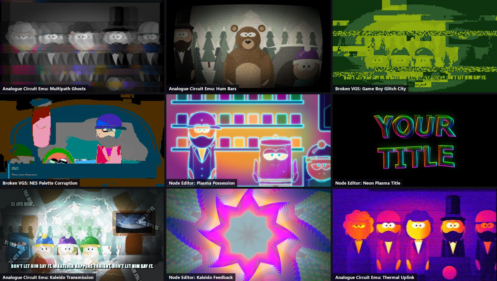
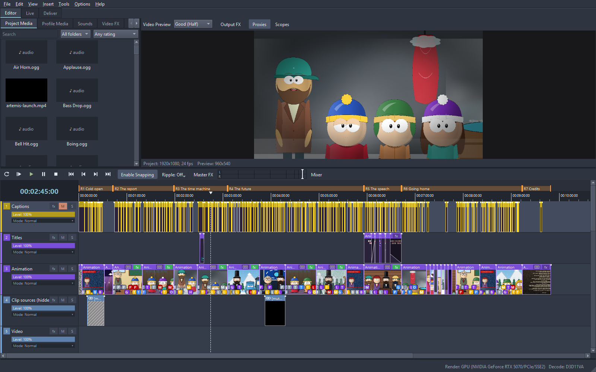
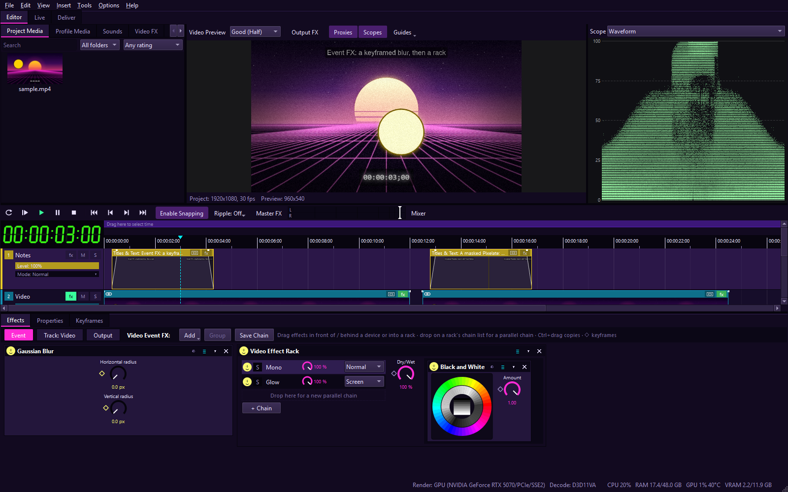
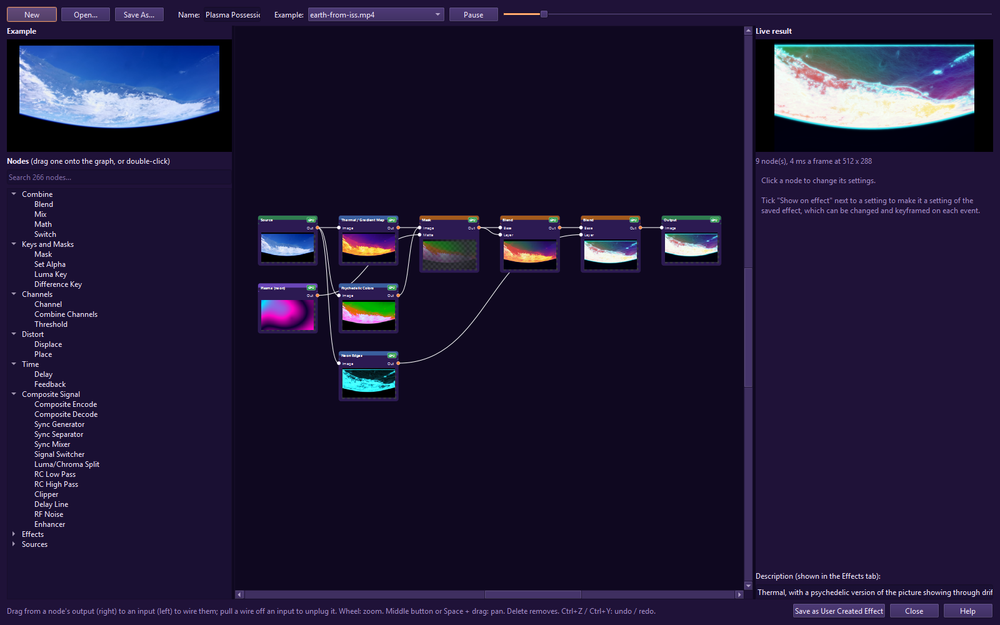
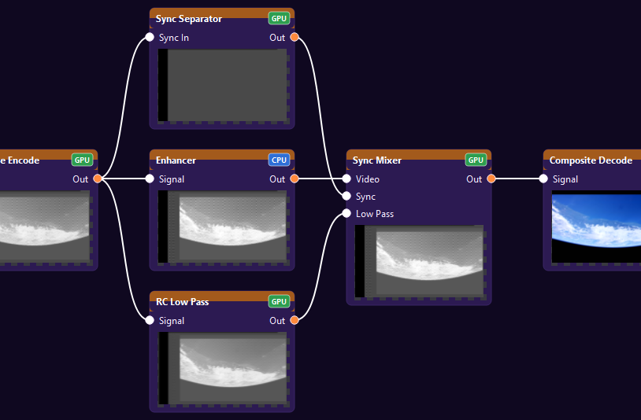
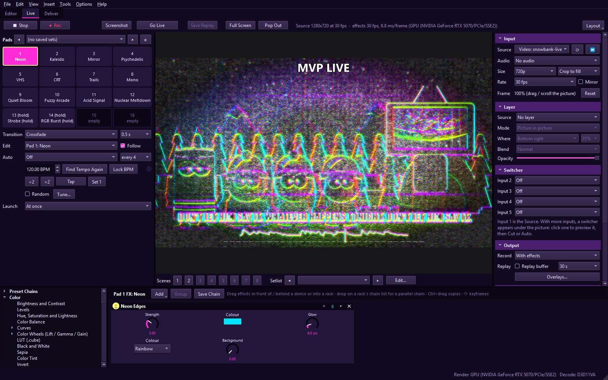
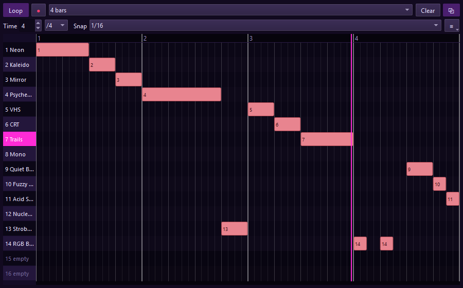
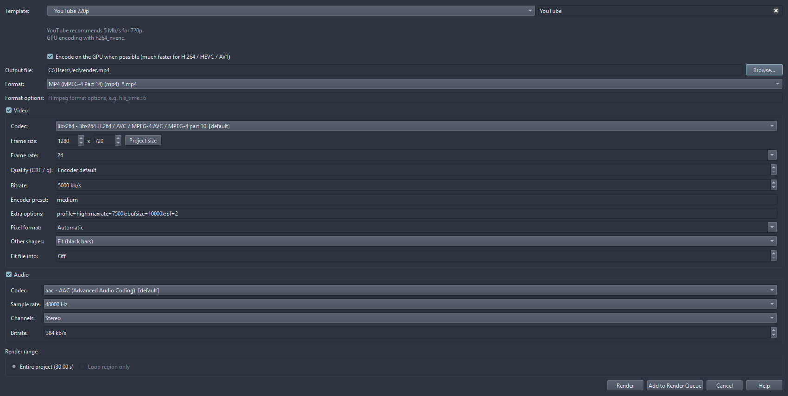
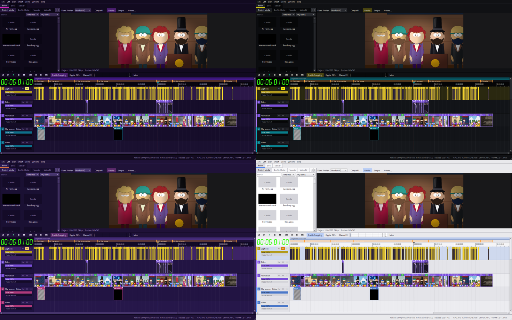

# Mutant Video Producer

  

<b>A free video editor, a live visuals rig and an effects lab in one program.</b>

  <a href="#download">Download</a> ·
  <a href="docs/README.md">User Guide</a> ·
  <a href="docs/tutorials/README.md">Tutorials</a> ·
  <a href="CHANGELOG.md">Changelog</a>

Mutant Video Producer (MVP) edits video, plays it live and ships it. Cut a vlog, a music video or a documentary in
the **Editor**. Throw cameras, screens and clips through effect pads in time with the music in **Live**. Check,
render and publish the result from **Deliver**. Build your own effects from nodes in the **Effect Builder**, down to
an emulated analogue TV signal, and use them in all three.

It runs on Windows and Linux, and it is free software (GPL v3), with no accounts, no watermarks and no
subscriptions.

| Workspace | What it's for |
|---|---|
| [**Editor**](#the-editor) | A multitrack timeline: cutting, effects and keyframes, sound and voices, captions, titles and animation. |
| [**Live**](#live) | Cameras, capture cards, screens, windows and video files through 16 effect pads in real time, with a beat-synced pad sequencer, layers, a switcher, recording and streaming. |
| [**Deliver**](#deliver) | Checks a finished edit, renders every output at once and writes the publish pack. |

---

## The Editor

The Editor is where a project is put together, from the first cut to the final mix.

- **Timeline editing**: video, audio and image tracks; trim, split, slip, slide and roll; ripple edits, groups,
  fades, envelopes, markers and regions; undo history and autosave with crash recovery.
- **Media**: Project Media with folders, ratings, search and in/out marks; proxies for heavy 4K, HEVC and 10-bit
  footage; **Create Clip from YouTube**; media libraries shared between projects through profiles.
- **Speed and time**: speed changes and ramps, reverse, frame blending and freeze frames.
- **Story tools**: chapters, compound sequences (an edit inside an edit) and **Director's Dice**, which rolls a fresh
  cut of the events you choose.
- **Smart tools**: **Edit by Transcript** (cut by deleting words), **Remove Silences**, split at scene changes or
  markers, **Auto Reframe for Vertical**, **Detect Beats** and **Make Beat Montage**.
- **Effects on every event, track and the whole output** (see [Effects](#effects) below), with masks, motion
  tracking, Pan/Crop, stabilisation and 27 transitions.

Every setting can be keyframed. The **Keyframes** tab shows a dope sheet of everything animated on an event, and a
graph where you drag the curves (linear, smooth, bezier, bounce, elastic and more).

### Sound, voices and captions

<table>
  <tr>
    <td></td>
    <td></td>
  </tr>
</table>

- **Mixing**: the Audio Mixer with faders, pan, solo, mute and meters; **auto ducking** under voices; a master
  volume line on the Editor's meter.
- **Audio effects**: EQ, compressor, true-peak limiter, reverb, delay, pitch shift, noise reduction, de-reverb and
  VST3 plugins, with presets; **Separate Stems** splits voice from music.
- **A sound effects library** (all CC0): whooshes, booms, air horns, rimshots, footsteps, doors and more.
- **Audio Finishing** measures loudness and true peaks and sets a safe master gain for YouTube, podcasts or broadcast.
- **Voices**: **Record Voice-Over** from your microphone, local text-to-speech, **RVC** voice conversion and the
  **Narration Studio** for scripts and alternate takes.
- **Captions**: **Auto Captions** with Whisper on your own computer, translation, speakers, SRT and WebVTT in and
  out, and subtitle tracks in renders.

Titles, lower thirds, charts and **Insert > Animation** scenes (2D layers, keyframes, characters with lip sync,
sets and a camera that follows whoever is talking) are built in as well: see
[Animation Scenes](docs/animation-scenes.md). The AI engines are optional downloads (**Tools > AI Components**) and
run offline once installed.

---

## Effects

Effects go on an event, a whole track, the project's output or the Live picture, in a **device chain** you can
reorder, bypass, save and share. **Racks** run chains side by side and mix them back together, and any effect can
be limited to part of the picture with shapes, freehand masks or rotoscoping.

- **The everyday kit**: colour curves and wheels, LUTs, colour match, keying and **AI Remove Background**, blur and
  sharpen, stylise, and the waveform, vectorscope, histogram and RGB parade scopes.
- **Analog and retro**: VHS, CRT, film, dithering and palettes, plus libretro **screen shaders**.
- **Glitch and psychedelic**: pixel sorting, datamosh, slice and block glitches, feedback, kaleidoscopes, melts and
  warps.
- **Broken VGS**: 125 ways for 34 game consoles and computers to fail: NES lockout blinking, Game Boy line death,
  PlayStation wobble, Amiga Guru Meditation and more.
- **Analogue Circuit Emu**: 37 effects that turn the picture into a real composite video signal, push it through
  emulated circuits (ghosting delay lines, overdriven amplifiers, broken sync) and show it on an emulated TV that
  locks, rolls and tears like a real one.
- **Node Editor**: 11 example effects made in the Effect Builder, from a hologram to a fractal tunnel.
- **Your own**: anything you build in the Effect Builder appears under **User Created**.

See [Effects](docs/effects.md) and the [Video Effects reference](docs/video-effects.md).

---

## The Effect Builder (Node Editor)

**Tools > Effect Builder** makes new video effects by wiring nodes together, with the result playing live as you
build it. Each node shows its own picture, so you can see what every step does.

- **266 nodes**: blends, maths and masks; luma and difference keys; channels; displacement; delays and **Feedback**
  (the effect's own last frame); a **Switch** between inputs; generators; and every video effect in the program as a
  node of its own.
- **Composite Signal nodes**: encode the picture as an NTSC or PAL composite signal (sync pulses, colour burst,
  subcarrier), then run it through a **Sync Separator**, **Sync Mixer**, **RC Low** and **High Pass** filters,
  **Delay Lines**, a **Clipper**, **RF Noise** and a one-transistor **Enhancer** solved as a circuit, onto a
  **Composite Decode** TV. Damage the sync and the picture rolls and tears as it would on real hardware.
- **Settings on the outside**: tick **Show on effect** next to any node setting and it becomes a setting of the saved
  effect, ready to change and keyframe on each event.
- **Save as User Created Effect** and it's in every effect menu, on the Editor's events and the Live pads alike, and
  travels inside the projects that use it.

The graph runs on the graphics card. Each node's label says where it ran in the preview: a green **GPU** or a blue
**CPU** (the Enhancer's circuit is solved sample by sample on the processor). Four Analogue Circuit Emu effects
stacked on the Live picture render in about 26 ms a frame on the GPU, against 83 ms on the CPU. See
[Effect Builder](docs/effects.md#effect-builder) and [GPU acceleration](docs/gpu-acceleration.md).

---

## Live

**Live** plays cameras, capture cards, screens, windows and video files through effects in real time, for a gig, a
stream or a recording.

- **16 effect pads** (keys `1 2 3 4 / Q W E R / A S D F / Z X C V`, or MIDI) switch whole effect chains with a
  crossfade or another transition; **momentary pads** stay on only while held; **Launch** waits for the next beat or
  bar. Pad sets save whole grids, and **Create Random Effects Chain** fills a pad with a chain that suits a chosen
  intensity, sometimes starting with a node effect.
- **Inputs**: a switcher with preview and program for up to five sources, and four **layers** (picture in picture or
  full frame, with blend modes, opacity and their own effects).
- **Scenes and setlists** recall a whole look, or a song's tempo and scene, in one press.
- **Tempo**: tap it, type it, take it from **MIDI clock**, or let **Beat Detection** find it in the music. Auto
  switch and modulation follow the beat.
- **Overlays**: text, logos, the tempo, a clock and audio visualisers (spectrum bars, a waveform, a ring), with an
  optional pulse on each beat.
- **Out**: record with a replay buffer, stream to Twitch, YouTube or any RTMP server with **Go Live**, show it full
  screen on another display, or send it to OBS through **Spout** or the virtual camera.

### The pad sequencer

Under the pads is a looping piano roll, one row for each pad. Click or drag to place blocks, and with **Loop** on
each block switches its pad on for its length, in time with the beat clock: the tapped tempo, the beats heard in the
music or MIDI clock.

- **Bars** from 1 to 64, any **time signature** (4/4, 3/4, 7/8...) and a **snap** from whole bars to 1/32 notes and
  triplets.
- **Ctrl+drag** to select blocks, then drag them along the bars or up and down onto other pads; **Ctrl+C**,
  **Ctrl+V**, **Ctrl+D** (duplicate) and **Delete**.
- **● Record** writes the pads you play into the loop as it goes round: jam the first pass, then let it play back.
- **⧉** pops the sequencer out into a window of its own, and **≡** saves and loads sequences by name.

See [Live](docs/live.md).

---

## Deliver

**Deliver** finishes a project. It checks the edit (offline media, gaps, loudness, YouTube chapters, length limits,
captions), renders it to several outputs at once from ready-made packs (YouTube, social, audio, masters), and
writes the publish pack: title, a description with chapters and tracklist, tags, thumbnail and captions. Every
render is kept in its History. See [Deliver](docs/deliver.md).

**Render As** has templates for YouTube, social video, editing formats, GIFs, image sequences and audio, with GPU
encoding (NVENC, AMF, Quick Sync), smart rendering of untouched cuts, framing for other shapes and size limits. See
[Rendering](docs/rendering.md).

---

## AI control

Turn on **Options > Allow AI Control (MCP)** and an AI assistant on your computer can work with you: cut, add effects,
build node effects, write and voice dialogue, caption, mix and render, with every change visible (and undoable) in
the program. See [AI Control](docs/ai-control.md).

## Plugins

**Tools > Plugins** runs commands written in JavaScript: a folder with a `plugin.json` and a script that edits the
project through the same commands as AI Control, in one undo step. **Lyric Video from LRC** comes with it. See
[Plugins](docs/plugins.md) to write your own.

## Make it yours

Seven themes (Classic, Neon Grid, Night City, Synthwave Sunset, Terminal, Arctic and Studio Light), custom keyboard
shortcuts, profiles with their own home folders, and GPU acceleration for the preview, effects, the Effect Builder,
Live and rendering, with a CPU fallback ([GPU guide](docs/gpu-acceleration.md)).

---

## Download

**[Releases](https://github.com/jeddyhhh/MutantVideoProducer/releases)**

- **Windows**: one installer `.exe` (about 160 MB) with Start menu shortcuts, `.mvp` file association and an
  uninstaller. A SHA-256 checksum comes with each release; the installer is not code-signed.
- **Linux**: an AppImage with Qt and FFmpeg inside: `chmod +x` it and run it.
- **From source**: see below.

Optional speech, voice and caption engines install from inside the program (**Tools > AI Components**).

## Learn

- [User Guide](docs/README.md), also in **Help > User Guide**.
- [Tutorials](docs/tutorials/README.md): eighteen lessons with example projects, from a first edit to an animated short,
  also in **Help > Tutorials**. The **Live Set** example has pads, scenes, a setlist and a sequence ready to play.
- [Keyboard Shortcuts](docs/shortcuts.md).

## Build

MVP is C++20 with Qt 6 and FFmpeg. Prepare the dependencies described in the
[build guide](docs/developer/building.md), then run `build.bat` (Windows) or `./build.sh` (Linux).

- [Architecture](docs/developer/architecture.md): how the program is organised.
- [Testing](docs/developer/testing.md): the test suites, GUI tests and the monkey tester.
- [Screenshots](docs/developer/screenshots.md): how the pictures on this page are made.
- [Contributing](CONTRIBUTING.md): building, testing, code style and the changelog.

## Licence

Mutant Video Producer is free software under the [GNU General Public License, version 3 or later](LICENSE).
Third-party components and their licences are listed in the [build guide](docs/developer/building.md#licences).
