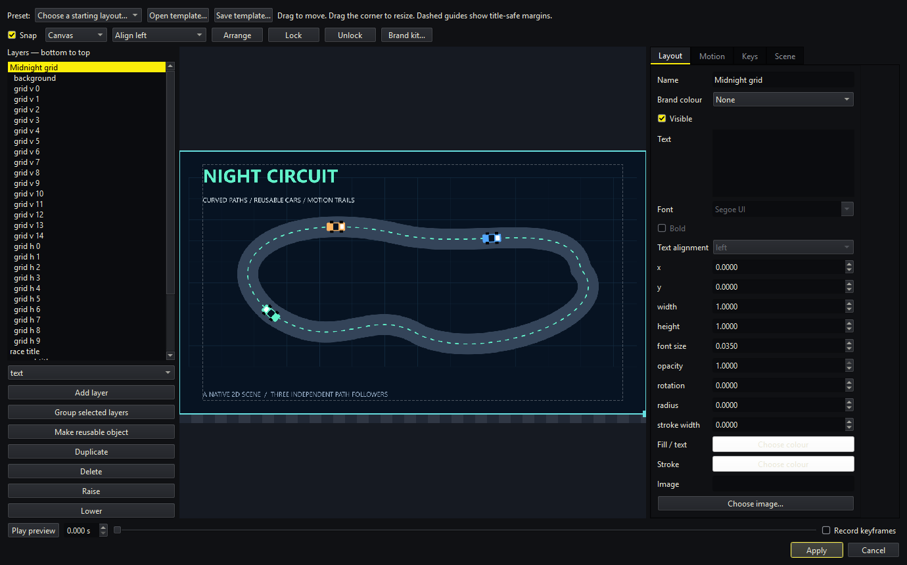
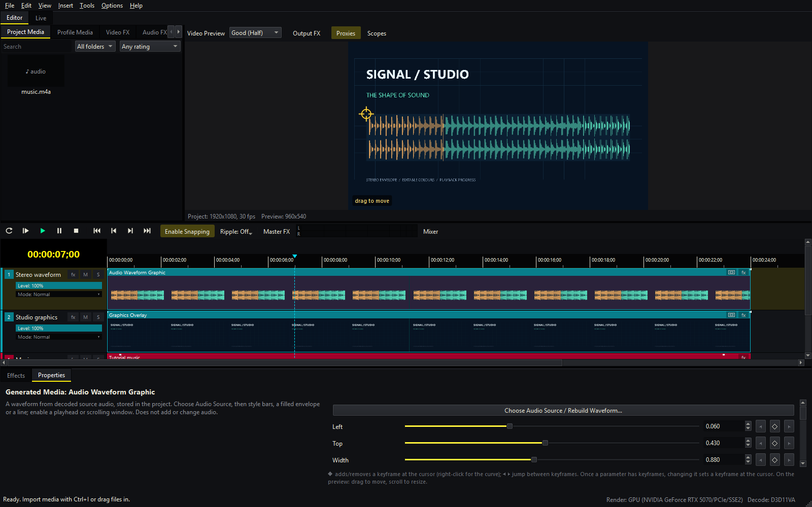
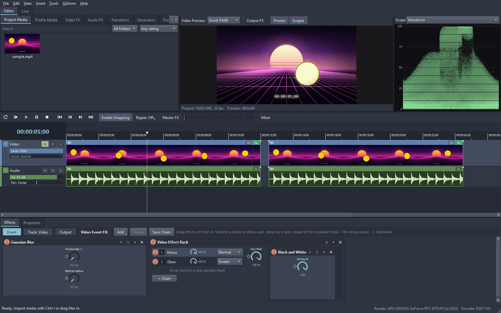
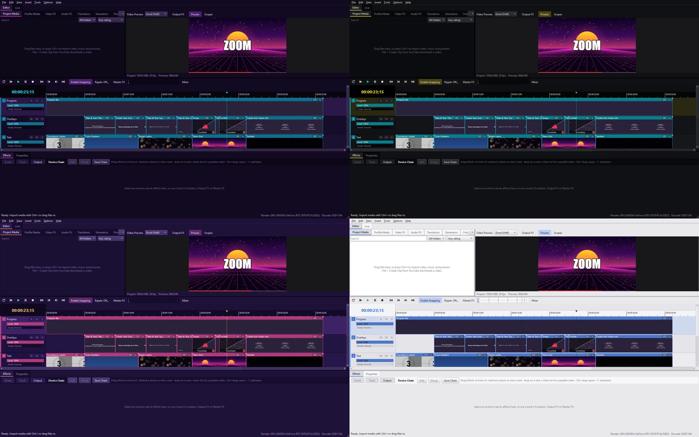

# Mutant Video Producer

<p align="center">
  
</p>

**Edit videos, compose animated graphics, finish your audio, and perform live visuals.**

Mutant Video Producer is a video editor for Windows and Linux with three workspaces:
**Editor** for building projects, **Live** for working with cameras, screens, windows and
video files in real time, and **Deliver** for checking a finished edit, rendering every
output at once and packing it for publishing. It combines a multitrack timeline,
native 2D graphics, local AI tools and MCP control in one application.

## Download

**[Download the Windows installer](https://github.com/jeddyhhh/MutantVideoProducer/releases/latest)**

The current Windows release is one standalone `.exe`, about **160 MB**. Run it to
install Mutant Video Producer, create Start menu and optional desktop shortcuts,
and associate `.mvp` projects with the application. Choose an installation folder
and install for yourself or all users. An uninstaller is included.

The release includes a SHA-256 checksum for verification. The installer is not
currently code-signed.

For Linux, releases after 0.2.6 include an AppImage with Qt and FFmpeg inside: make it
executable (`chmod +x`) and run it. To build it yourself, follow the
[build instructions](docs/developer/building.md). Maintainers can also access tested
development builds in the repository's draft releases. Download portable or offline
archives when they are listed on a release; offline archives come with milestone releases.

### Optional AI engines

Install speech generation and RVC conversion through **Tools > AI Components**.
The application downloads private Python and pinned dependencies directly from
Astral, PyPI and PyTorch, with progress, cancellation and repair controls. No
separate Python or CUDA Toolkit installation is needed.

Choose CPU or NVIDIA CUDA support, then download the voices and models you want.
Installed engines work offline, and previously generated narration plays and renders
without the generation engines. See [AI Components](docs/ai-components.md) for setup
and acceleration requirements.

If the repository is private, GitHub downloads require repository access. Check the
Releases page while signed in; the application's update check cannot read private
releases. AI dependency downloads use their upstream sources independently.

## Edit and organise

Work with video, audio and dedicated image tracks. Trim, split, slip, slide and roll
events; group related clips; use ripple editing, fades, envelopes, markers and regions.
Adjust timing with speed ramps, reverse playback, frame blending and freeze frames.

Project Media provides folders, ratings, search and in/out marks. Proxies help with
heavy footage, and recordings and YouTube downloads have their own media bins.
Profiles provide selectable home folders and shared media libraries across projects.
**Collect Project and Media** gathers a project and its dependencies for moving or
sharing. Autosave, crash recovery, crash reports and undo history support everyday editing.
Story chapters lay out a documentary, compound sequences nest one edit inside another, and
**Director's Dice** rolls a fresh cut of the events you choose.


## Compose graphics and animation

Build titles, lower thirds, broadcast layouts, charts and animated scenes directly
inside the editor. The general 2D graphics engine supports parented layers, reusable
objects, curved paths, keyframes, easing, morphing, masks, cameras, particles and
repeaters. Audio and beat bindings connect animation to your soundtrack. A character library brings
cut-out characters whose mouths take the shape of their words and follow their voice track through later edits,
with expressions and gestures; a set library gives them backgrounds, video can play inside a scene (a TV, a window),
and a camera that frames whoever is talking does the cutting. Ready-made moves, per-layer effects, soft shading,
contact shadows, depth of field and motion blur finish the look.

Make cut-out cartoons too: bind a scene to each character's voice track and their mouth, arms and body
move with their own lines, through every line in the shot. The [animated short tutorial](docs/tutorials/17-animated-short.md)
builds characters, lip sync and camera cuts step by step.

Snapping, alignment, distribution, layer locks and reusable brand kits help keep
layouts consistent. Scenes remain editable and use the same renderer in preview
and export. Learn more about [animation scenes](docs/animation-scenes.md).



Generate waveform graphics from real source audio: stereo bars, envelopes or lines,
with playback progress and scrolling options.



## Shape the picture

Use colour curves, colour wheels, LUTs, keying, stylisation, glitch, analog, retro and
psychedelic effects. Build keyframed effect chains, save presets and racks, and add
transitions between events. Masks, freehand masks, rotoscoping, motion tracking,
stabilisation and AI background removal provide more control over the image.

Video scopes help assess the result. Supported preview, rendering and effect paths
use GPU acceleration, with CPU fallback where needed. The
[GPU guide](docs/gpu-acceleration.md) explains which stages use hardware acceleration.



## Finish sound, captions and narration

Mix with EQ, dynamics, reverb, delay, pitch tools, noise reduction, audio presets and
VST3 plugins. A built-in library of royalty-free (CC0) sound effects (whooshes, booms, air horns,
dings, rimshots and more) sits in the **Sounds** tab, ready to drag onto the timeline. Use the Audio Mixer, automatic ducking and beat detection to balance
speech and music. [Audio Finishing](docs/audio-finishing.md) checks final-mix loudness,
true peaks and stereo compatibility, with editable targets and undoable gain changes.

Generate captions locally with Whisper, translate them, distinguish speakers, and
import or export SRT and WebVTT subtitles. Create local speech from captions with
downloadable voices, or speak a whole `Name: line` script with a voice and pitch per character, each
on their own track; integrated RVC conversion turns speech into another voice model.
Narration Studio keeps scripts and alternate takes with the project.

See [captions and narration](docs/captions.md) and
[story, narration and sequences](docs/story.md) for the complete workflows.

## Perform live visuals

Use cameras, screens, windows and video files as sources. Switch between four inputs,
combine layers, launch effects from 16 pads, and use scenes and setlists to organise
a performance. Beat-synchronised transitions, modulation, MIDI and MIDI clock help
connect visuals to music.

Add overlays and audio visualisers, record performances, capture a replay buffer,
stream to services such as Twitch and YouTube, or send video to OBS. Spout and the
OBS virtual camera are available on Windows. See the [Live guide](docs/live.md).


## Deliver

The **Deliver** tab checks a finished edit (offline media, gaps, loudness, YouTube chapters, length limits,
captions), renders it to several outputs at once from ready-made packs (YouTube, social, audio, masters, share),
and writes the publish pack: title, description with chapters and tracklist, tags, thumbnail and captions.
Every render goes into its History. See [Deliver](docs/deliver.md).

## Render and automate

Export using templates for social video, editing formats, GIFs, image sequences and
audio. Adjust framing for different aspect ratios and use supported GPU encoders.
A detailed render status window reports progress, including exports started through
MCP. See [rendering](docs/rendering.md).

Enable **Options > Allow AI Control (MCP)** to let a compatible assistant work with
the open project. MCP tools cover editing, graphics, animation, captions, narration,
Live controls and rendering. The assistant's changes remain visible in the editor.
See [AI Control](docs/ai-control.md) for connection instructions and available tools.

## Make the workspace yours

Choose from Classic, Neon Grid, Night City, Synthwave Sunset, Terminal, Arctic and
Studio Light under **View > Theme**.



## Learn and build

- [User Guide](docs/README.md): features, settings and workflows; also available in **Help > User Guide**.
- [Tutorials](docs/tutorials/README.md): eighteen guided lessons with example projects; open **Help > Tutorials**.
- [Keyboard Shortcuts](docs/shortcuts.md): commands and custom key bindings.
- [Building](docs/developer/building.md): dependencies and platform-specific instructions.
- [Architecture](docs/developer/architecture.md): how the application is organised.
- [Testing](docs/developer/testing.md): verification tools and regression suites.
- [Changelog](CHANGELOG.md): changes and release history.
- [Contributing](CONTRIBUTING.md): building, testing, code style and the changelog.

The application is written in C++20 with Qt 6 and FFmpeg. After preparing the
dependencies described in the build guide, run:

**Windows**

```bat
build.bat
```

**Linux**

```sh
./build.sh
```

## Licence

Mutant Video Producer is free software under the
[GNU General Public License, version 3 or later](LICENSE). Third-party components
and their licences are listed in the [build guide](docs/developer/building.md#licences).
