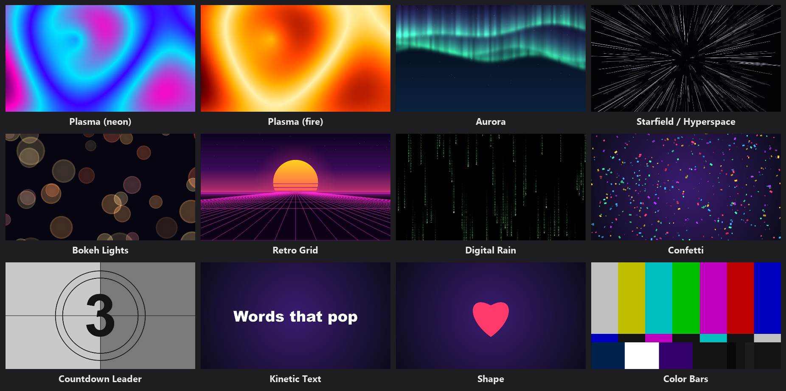

# Mutant Video Producer

A video editor for Windows and Linux, with a real-time **Live** workspace for performing effects on
cameras, screens and video files. C++20 on top of FFmpeg and Qt 6.

Previously named Montage. Existing `.mtg` projects, collected projects, saved presets,
profiles and their media libraries remain compatible. See [rename compatibility](docs/rename.md).

Anything FFmpeg can read can be imported: more than 360 container formats and about 520 audio and
video decoders, from AV1 and HEVC 10-bit down to Nintendo 3DS camera AVIs, `.3gp` phone clips,
RealMedia, Cinepak, DV and still images. Renders can go to any of about 150 output formats.


**Effects and scopes**: the device chain under the timeline, the waveform scope beside the preview.


**Live**: a video (or camera, screen, window) through effect pads in real time, ready to record,
stream or send to OBS.


**Themes**: Neon Grid, Night City, Synthwave Sunset and Studio Light (View > Theme).


**Transitions** and **generators**:




## Features

**Editing**: multitrack timeline; trimming, splitting, slip, slide and roll; auto ripple; groups;
fade curves; markers and regions; a beat grid; envelopes; speed changes, reverse, frame blending,
speed ramps and freeze frames; Project Media with folders, ratings, search and in / out marks;
proxies for heavy footage; Create Clip from YouTube; autosave and crash recovery; History.

**Effects**: 68 video effects, from colour grading (Curves, Color Wheels, LUTs) to glitch,
analog, psychedelic and 128 *Broken Video Game Systems* effects; 27 transitions; a device chain
with keyframes, presets and racks; masks, freehand masks, rotoscoping and motion tracking;
stabilisation; **Remove Background (AI)** on the GPU; Follow Audio; video scopes. Everything also
renders on the GPU, with the same result as the CPU.

**Titles and generators**: styled and animated titles, kinetic text, credits, timecode, animated
backgrounds, overlays, shapes and colour bars.

**Native graphics and animation**: editable broadcast layouts and a general 2D composer with
parented layers, visual keyframes, easing, curved paths, morphing, masks, cameras, reusable objects,
data charts, audio/beat bindings, particles, repeaters and motion effects. All are available through
MCP and use the same renderer in preview and export. See [Animation scenes](docs/animation-scenes.md).

**Audio**: EQ, dynamics, reverb, delay, pitch, noise reduction and more, about 100 presets, VST3
plugins, an Audio Mixer, auto ducking and beat detection.

**Captions**: Auto Captions with Whisper on this computer (GPU or CPU), translation, speaker
colours, SRT and WebVTT, subtitle tracks in renders.

**Rendering**: about 170 templates (YouTube, TikTok, Instagram, Discord size limits, ProRes,
DNxHR, GIF, image sequences, audio only, retro consoles...), GPU encoders, framing for other shapes.

**Live**: cameras, screens, windows and video files; a four-input switcher; layers; 16 effect pads
with transitions, launched on the beat; tempo and beat detection; scenes and setlists; modulation;
MIDI and MIDI clock; overlays and audio visualisers; recording and a replay buffer; streaming to
Twitch, YouTube and others; Spout and the OBS virtual camera.

**Themes**: seven looks under View > Theme, from Classic to two cyberpunk themes (Neon Grid, Night
City), Synthwave Sunset, Terminal, Arctic and Studio Light.

**AI control**: an AI assistant on your computer (Claude Code, Claude Desktop, any MCP client) can
edit with you, one undoable step at a time.

## Documentation

- **[User Guide](docs/README.md)**: every feature, how to use it, and its details. In Mutant Video Producer,
  **Help > User Guide**.
- **[Tutorials](docs/tutorials/README.md)**: sixteen step-by-step lessons with example projects.
  In Mutant Video Producer, **Help > Tutorials**.
- [Keyboard Shortcuts](docs/shortcuts.md).

## Getting Mutant Video Producer

From the [Releases](../../releases) page, download and run **MutantVideoProducer-&lt;version&gt;-win64-setup.exe**: it
installs Mutant Video Producer in Program Files (or only for you, without admin rights), adds it to the Start menu, opens `.mtg` projects with a
double-click, and can be removed from Windows' *Installed apps*. Or download the zip and unpack it
anywhere. The *offline* zip also holds every speech model for Auto Captions, for computers without
internet.

The first time it starts, Mutant Video Producer shows a welcome window with the tutorials, example projects and a
check of what your computer can do.

The installer isn't code-signed yet, so Windows may say "Windows protected your PC": click **More
info**, then **Run anyway**.

To build it yourself, see [Building Mutant Video Producer](docs/developer/building.md). In short, on Windows with
Visual Studio and Qt and FFmpeg in `deps\`:

```bat
build.bat
```

and on Linux:

```sh
./build.sh
```

[Architecture](docs/developer/architecture.md) and [Testing](docs/developer/testing.md) describe
the code and its self-tests.

## Licence

Mutant Video Producer is free software: you can redistribute it and/or modify it under the terms of the
[GNU General Public License, version 3](LICENSE) or (at your option) any later version. It comes
with no warranty. The parts it is built with and their licences are listed in
[Building Mutant Video Producer](docs/developer/building.md#licences); what changed in each version is in the
[changelog](CHANGELOG.md).
