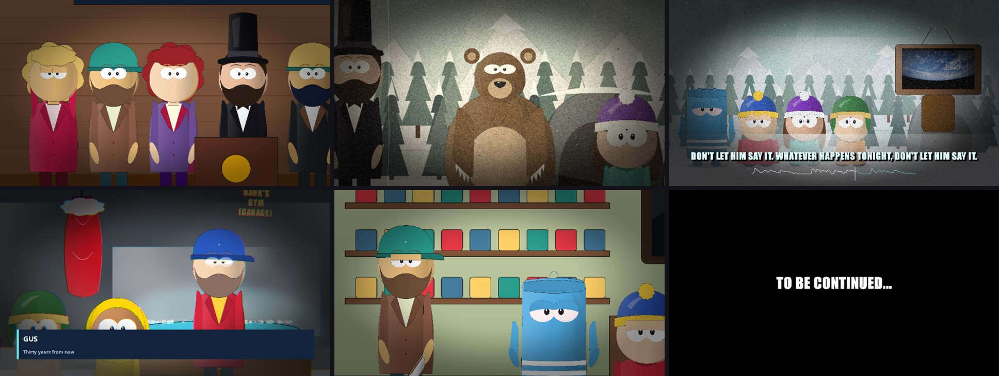
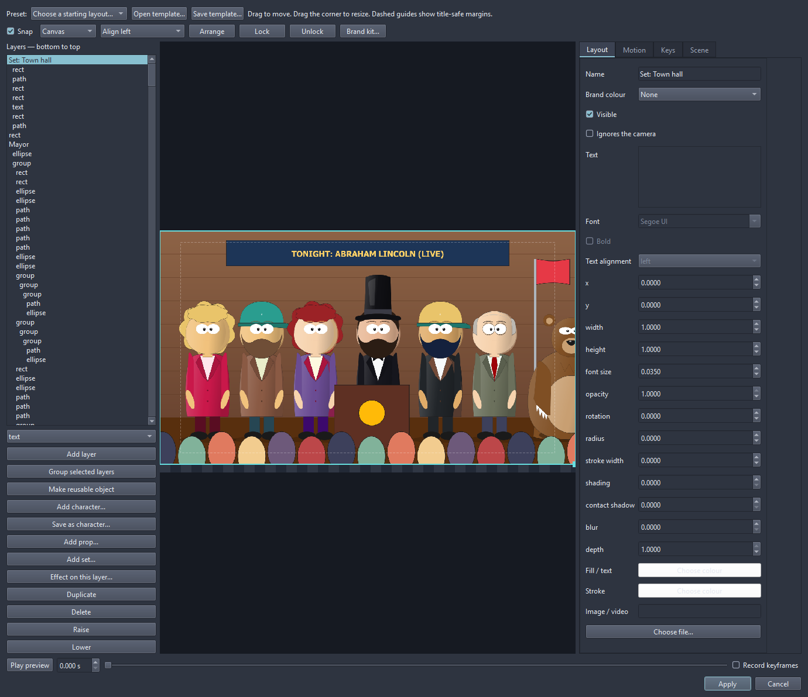
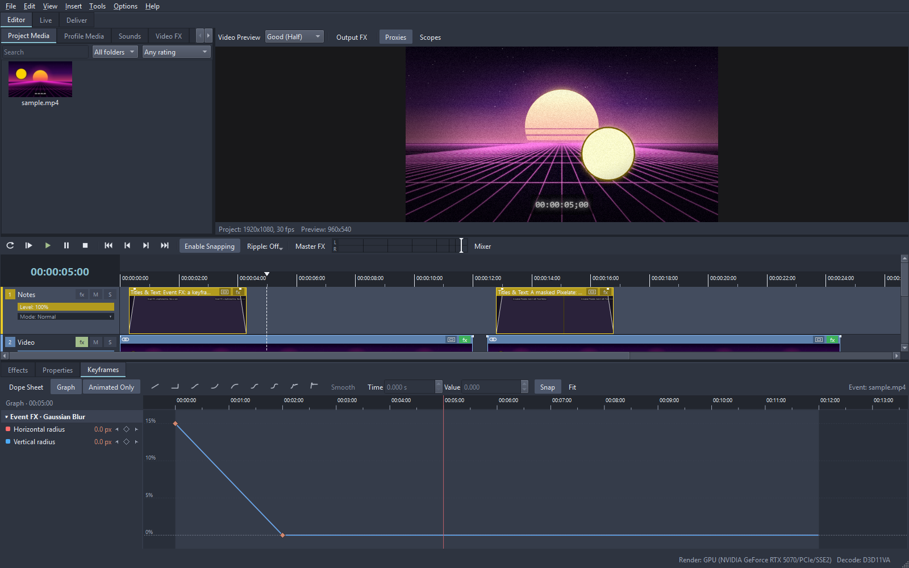
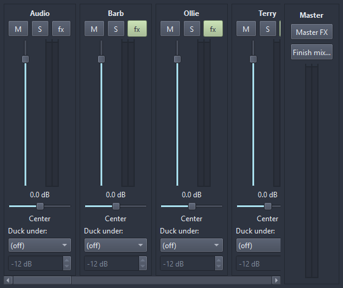
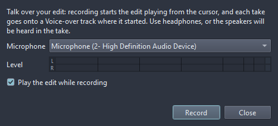
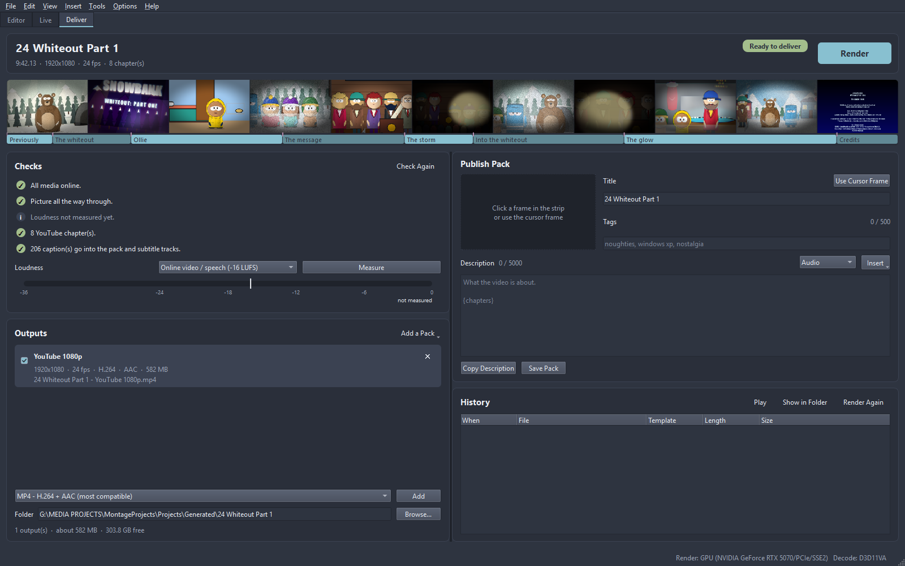

# Mutant Video Producer

  

<b>A free video editor that also animates cartoons, voices them, mixes the sound, plays live visuals and ships the result.</b>

  <a href="#download">Download</a> ·
  <a href="docs/README.md">User Guide</a> ·
  <a href="docs/tutorials/README.md">Tutorials</a> ·
  <a href="CHANGELOG.md">Changelog</a>

*Every frame above is from **Snowbank**, a ten-minute-an-episode cartoon series written, drawn, animated, voiced,
captioned, mixed and rendered inside Mutant Video Producer: the characters, sets, lip sync, camera work, subtitles,
lower thirds, snowstorms and the "TO BE CONTINUED" all come from the program's own tools.*

Mutant Video Producer (MVP) runs on Windows and Linux and has three workspaces:

- **Editor**: a multitrack timeline with effects, keyframes, transitions, an animation studio, audio mixing,
  captions and voices.
- **Live**: cameras, screens, windows and video files through effect pads in real time, recorded or streamed.
- **Deliver**: checks a finished edit, renders every output at once and writes the publish pack.

It is free software (GPL v3), with no accounts, no watermarks and no subscriptions. The About box will tell you it is
registered to someone called Hugh Jass. It isn't.

---

## The Editor

- **Timeline editing**: video, audio and image tracks; trim, split, slip, slide and roll; ripple, groups, fades,
  envelopes, markers and regions; undo history and autosave with crash recovery.
- **Speed and time**: speed changes, speed ramps, reverse, frame blending and freeze frames.
- **Media**: Project Media with folders, ratings, search and in/out marks; proxies for heavy 4K / HEVC / 10-bit
  footage; **Create Clip from YouTube**; shared media libraries across projects with profiles.
- **Story tools**: documentary chapters, compound sequences (an edit inside an edit) and **Director's Dice**, which rolls
  a fresh cut of the events you choose.
- **Smart tools**: **Edit by Transcript** (cut by deleting words), **Remove Silences**, split at scene changes or
  markers, **Auto Reframe for Vertical**, **Detect Beats** and **Make Beat Montage**.

## Animation studio

**Insert > Animation** makes a clip you build in **Compose Animation**: a full 2D scene engine with layers, groups,
paths, keyframes and easing, masks, particles, cameras and reusable objects. On top of it sits a cartoon kit:

- **Characters** from a library (kids, adults, a teacher, a bear, Terry the towel...) whose colours, hair and clothes
  are settings, with expressions, gestures, **props** in their hands and **moves** (walk in, walk out, sit, fall,
  float, dance on the beat).
- **Lip sync**: bind a character to its voice track and its mouth takes the shape of every word, even after you edit the
  track, and even when a line plays backwards.
- **Sets**: classrooms, kitchens, snowy streets, woods with a cave, mission control, outer space and more, with signs
  you reword as settings.
- **A camera that frames whoever is talking**, with reaction shots, two-shots and wide shots, and no flicking between
  people. Layers marked **Ignores the camera** (lyrics, captions, logos) stay put through every close-up.
- **The look**: video playing inside a scene (a TV, a window), per-layer effects, soft shading, contact shadows, depth
  of field, motion blur, fog, film grain, TV static, lightning flashes and slow motion.
- **Generate Dialogue** speaks a whole `Name: line` script, a voice and pitch per character, each on its own track.

Graphics Overlays use the same engine for titles, lower thirds, charts, broadcast layouts and waveform graphics, with
snapping, alignment, layer locks and brand kits. See [Animation Scenes](docs/animation-scenes.md) and the
[animated short tutorial](docs/tutorials/17-animated-short.md).

## Effects and keyframes

- **Video effects**: colour curves and wheels, LUTs, keying and **AI Remove Background**, blur and sharpen, stylise,
  analog and retro (VHS, CRT, dithering, palettes), psychedelic and distortion, glitch, and **Broken Video Game
  Systems** (NES lockout, Game Boy line death, PlayStation wobble, Amiga Guru Meditation...).
- **Device chain**: stack effects, build parallel **racks**, save chains and presets, and mask any effect with shapes,
  freehand masks or rotoscoping.
- **Motion**: Pan/Crop, motion tracking, Follow Audio and stabilisation.
- **Transitions**: crossfades, fades and 27 transitions.
- **Scopes**: waveform, vectorscope, histogram and RGB parade.

Every setting can be keyframed. The **Keyframes** tab shows a dope sheet of everything animated on an event, and a
graph where you drag the curves (linear, smooth, bezier, bounce, elastic and more).

## Sound, voices and captions

<table>
  <tr>
    <td></td>
    <td></td>
  </tr>
</table>

- **Mixing**: the Audio Mixer with faders, pan, solo / mute and per-track meters; **auto ducking** turns the music down
  under a voice; drag the line on the Editor's meter to set the **master volume**.
- **Audio effects**: EQ, compressor, true-peak limiter, reverb, delay, pitch shift, noise reduction and VST3
  plugins, with presets.
- **A sound effects library** (all CC0): whooshes, booms, air horns, rimshots, sad trombones, "dun dun dunnn",
  footsteps, doors and more, ready to drag onto the timeline.
- **Audio Finishing** measures integrated loudness and true peaks and sets a safe master gain for YouTube, podcasts or
  broadcast.
- **Voices**: **Record Voice-Over** talks over the edit from your microphone; local text-to-speech voices read
  captions or scripts; **RVC** converts speech into another voice model; **Narration Studio** keeps scripts and
  alternate takes with the project.
- **Captions**: **Auto Captions** with Whisper on your own computer, translation, speakers, SRT and WebVTT in and out,
  and subtitle tracks in renders.

The AI engines are optional downloads (**Tools > AI Components**), run offline once installed, and need no separate
Python or CUDA install. See [Audio](docs/audio.md), [Audio Finishing](docs/audio-finishing.md) and
[Captions and Narration](docs/captions.md).

## Deliver

The **Deliver** tab checks a finished edit (offline media, gaps, loudness, YouTube chapters, length limits, captions),
renders it to several outputs at once from ready-made packs (YouTube, social, audio, masters), and writes the publish
pack: title, a description with chapters and tracklist, tags, thumbnail and captions. Every render goes into its
History. See [Deliver](docs/deliver.md).

**Render As** has templates for YouTube, social video, editing formats, GIFs, image sequences and audio, with GPU
encoding (NVENC, AMF, Quick Sync), framing for other shapes and size limits. See [Rendering](docs/rendering.md).

## Live

Play cameras, capture cards, screens, windows and video files through **16 effect pads**. Switch between inputs, lay one
source over another, save scenes and setlists, and sync transitions to the beat with tempo detection, MIDI and MIDI
clock. Add overlays and audio visualisers, record with a replay buffer, stream to Twitch or YouTube, or send the
picture to OBS through Spout or the virtual camera. See [Live](docs/live.md).

## AI control

Turn on **Options > Allow AI Control (MCP)** and an AI assistant on your computer can edit with you: cut, add effects,
build animation scenes, write and voice dialogue, caption, mix and render, with every change visible (and undoable) in
the editor. The Snowbank episodes were directed this way. See [AI Control](docs/ai-control.md).

## Make it yours

Seven themes (Classic, Neon Grid, Night City, Synthwave Sunset, Terminal, Arctic and Studio Light), custom keyboard
shortcuts, profiles with their own home folders, and GPU acceleration for the preview, effects, scenes and rendering
with a CPU fallback ([GPU guide](docs/gpu-acceleration.md)).

---

## Download

**[Releases](https://github.com/jeddyhhh/MutantVideoProducer/releases)**

- **Windows**: one installer `.exe` (about 160 MB) with Start menu shortcuts, `.mvp` file association and an
  uninstaller. A SHA-256 checksum comes with each release; the installer is not code-signed.
- **Linux**: an AppImage with Qt and FFmpeg inside: `chmod +x` it and run it.
- **From source**: see below.

Optional speech, voice and caption engines install from inside the program (**Tools > AI Components**).

## Learn

- [User Guide](docs/README.md), also in **Help > User Guide**.
- [Tutorials](docs/tutorials/README.md): eighteen lessons with example projects, from a first edit to an animated short,
  also in **Help > Tutorials**.
- [Keyboard Shortcuts](docs/shortcuts.md).

## Build

MVP is C++20 with Qt 6 and FFmpeg. Prepare the dependencies described in the
[build guide](docs/developer/building.md), then run `build.bat` (Windows) or `./build.sh` (Linux).

- [Architecture](docs/developer/architecture.md): how the program is organised.
- [Testing](docs/developer/testing.md): the test suites, GUI tests and the monkey tester.
- [Screenshots](docs/developer/screenshots.md): how the pictures on this page are made.
- [Contributing](CONTRIBUTING.md): building, testing, code style and the changelog.

## Licence

Mutant Video Producer is free software under the [GNU General Public License, version 3 or later](LICENSE).
Third-party components and their licences are listed in the [build guide](docs/developer/building.md#licences).
