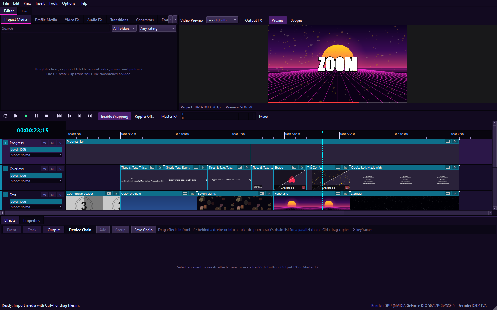

# Mutant Video Producer User Guide

Mutant Video Producer is a video editor with two workspaces: the **Editor**, where you cut, add effects, mix
sound and render, and **Live**, where you play effects on a camera, a screen or video files in
real time and record or stream the result. In Mutant Video Producer, choose **Help > User Guide** to open this
guide, and **Help > Tutorials** to open the step-by-step tutorials and their example projects.

## Start here

- [Getting Started](getting-started.md): the window, a first edit from import to render.
- [Rename Compatibility](rename.md): existing projects, profiles, settings and MCP clients.
- [Tutorials](tutorials/README.md): sixteen step-by-step lessons, most with an example project to open.
- [Keyboard Shortcuts](shortcuts.md): every key, and how to change them.

## The Editor

- [Story, Narration and Sequences](story.md): documentary chapters, local narration takes, compound clips and Director's Dice.

- [Profiles and Home Folders](profiles.md): separate projects and downloads, with media bins shared across projects.
- [Media](media.md): importing, Project Media (folders, ratings, search, in / out marks), Create
  Clip from YouTube, proxies, missing media, autosave and recovery.
- [Editing on the Timeline](editing.md): events and tracks, trimming, splitting, moving, auto ripple,
  slip, slide and roll, groups, fades, markers and regions, the grid, envelopes, playback, undo and History.
- [Speed and Time](speed.md): playback speed, reverse, slow motion, speed ramps and freeze frames.
- [Effects](effects.md): the device chain, keyframes, presets, racks, masks and freehand masks, motion
  tracking, Follow Audio, Pan/Crop and stabilisation.
- [Video Effects](video-effects.md): every video effect: colour and grading, stylise, keying and
  Remove Background (AI), glitch, Broken Video Game Systems, analog and retro, psychedelic and
  distort; and the video scopes.
- [Transitions](transitions.md): crossfades, fades and the 27 transitions.
- [Titles and Generators](titles-and-generators.md): text, titles, kinetic text, credits, animated
  backgrounds, overlays, shapes and test patterns.
- [Audio](audio.md): audio effects and presets, VST3 plugins, the Audio Mixer, auto ducking, meters,
  scrubbing and beat detection.
- [Captions and Subtitles](captions.md): Auto Captions with Whisper, translation, speakers, SRT and
  WebVTT, subtitle tracks in renders, local AI voice generation and RVC conversion.
- [Rendering](rendering.md): Render As, the templates, size limits, framing, GPU encoders, frames as images.

## Live

- [Live](live.md): sources, the switcher, layers, pads, scenes, the setlist, tempo and beat detection,
  modulation, MIDI, overlays, recording, the replay buffer, streaming, Spout and the virtual camera.

## Everything else

- [Options](options.md): every setting in the Options menu.
- [AI Control (MCP)](ai-control.md): letting an AI assistant on your computer edit with you.

## For developers

- [Building Mutant Video Producer](developer/building.md)
- [Architecture](developer/architecture.md)
- [Testing](developer/testing.md)
