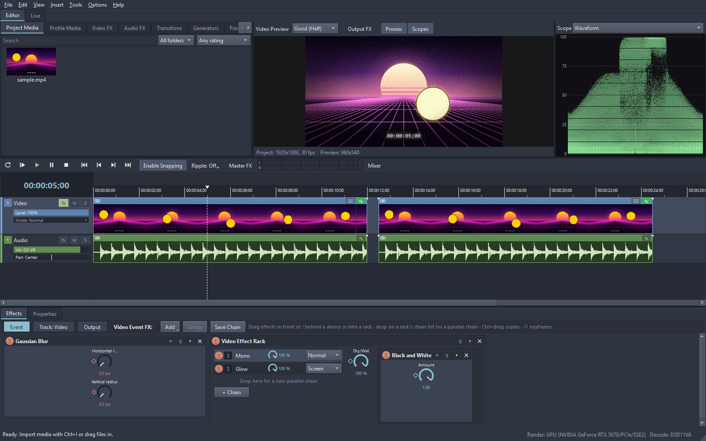
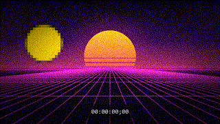

# Effects

Effects work the same way on video and audio. This page covers how to add, set and animate them.
[Video Effects](video-effects.md) and [Audio](audio.md) list the effects themselves.

## Where effects go

An effect can sit at four levels. Each is processed in this order:

1. **Event FX**: on one event.
2. **Transitions** between events (see [Transitions](transitions.md)).
3. **Track FX**: on everything on a track.
4. **Output FX**: on the finished picture (**Edit > Video Output FX...**), or **Master FX** on the
   finished sound (**Edit > Audio Master FX...**, or the *Master FX* button on the transport bar).

## Adding an effect

- Drag an effect from the **Video FX** or **Audio FX** tab:
  - onto an **event**, for event FX;
  - onto an **empty part of a track or its header**, for track FX;
  - into the **device chain**, in front of or behind a device.
  The timeline highlights where it will go.
- Or double-click it in the browser, or pick it from the **Add** button on the device chain.
- **Ctrl+E** (**Edit > Event FX...**) shows the selected event's effects.

## The device chain

The **Effects** tab at the bottom shows a chain as a row of devices, each with all its controls.
The **Event / Track / Output** tabs above it switch between:

- the selected event's effects,
- its track's effects,
- the whole output (*Master* for audio).

Clicking a track header, its **fx** button, or **Track FX** in an event's right-click menu shows the track's chain.

**Controls**:

- **Knobs**: drag up or down; hold **Shift** for fine steps; use the mouse wheel; double-click to reset.
- Right-click any control:
  - **Enter Value...** to type a number,
  - **Reset to Default**,
  - keyframe commands,
  - **Follow Audio...**.

**Devices**:

- Each device has an **on / off** button, **fold**, and **delete**. Right-click a device for
  duplicate and group.
- Drag a device by its title bar to reorder it. **Ctrl+drag** copies it.
- Make the panel taller (drag the divider above it) and the controls stack into more rows, so more
  devices fit side by side.

## Keyframes

Any number, and any colour, can change over time.

- The **◇** next to a control adds a keyframe at the cursor.
- Once a setting has keyframes its value turns orange, and changing it sets a keyframe at the cursor.
- Right-click the control:
  - **Add / Remove Keyframe at Cursor**,
  - **Previous Keyframe** / **Next Keyframe**,
  - **Keyframe Curve**: the curve to the next keyframe (see below),
  - **Edit in Keyframe Editor...**.
- Event FX keyframes move with the event. Track and output keyframes follow timeline time.

The curves:

| Curve | Between this keyframe and the next |
|---|---|
| Linear | Changes at a steady rate. |
| Hold | Stays, then jumps at the next keyframe. |
| Smooth | Starts and arrives gently. |
| Ease In / Ease Out / Ease In/Out | Starts slowly / arrives slowly / both, more strongly than Smooth. |
| Bezier | Any shape: drag its two handles in the Keyframe Editor's graph. |
| Bounce | Arrives, then bounces like a dropped ball. |
| Elastic | Overshoots and springs back. |

Colours follow the same timing; a Bezier curve between colours runs as Smooth.

## The Keyframe Editor

The **Keyframes** tab, beside Effects and Properties, shows every keyframe of what Effects shows:
an event (its Event FX with racks, Pan/Crop, its text or generated media, and its transitions), a
track's FX, the video output or the audio master. **Animated Only** lists the settings that have
keyframes; turn it off to add keyframes to any of them.

On the left, each setting shows its value at the cursor. **◀ ▶** go to its previous or next
keyframe, and **◇** adds or removes one at the cursor. Click a group's name to fold it.

**Dope Sheet** shows one row per setting, with each keyframe as a mark. Its shape shows the curve
that follows it: a diamond (Linear), square (Hold), circle (Smooth and the eases), dotted diamond
(Bezier) or triangle (Bounce, Elastic). A group's row has a mark wherever any of its settings has a
keyframe; moving that mark moves them all.

- Click a keyframe to pick it. **Shift+click** adds, **Ctrl+click** adds or removes, and dragging
  a box over empty space picks what is inside. Click a setting's name to pick all of its keyframes.
- Drag picked keyframes to move them, in whole frames. With **Snap** on they also stop at the
  cursor, other keyframes and the event's ends. **Alt+drag** copies them.
- With two or more picked, a bar over the ruler spans them: drag either end to stretch or squeeze
  their timing.
- Double-click a row to add a keyframe there. Double-click a keyframe to move the cursor to it.

**Graph** draws the curves themselves, each scaled to its setting's range. Click setting names to
choose which curves show (Ctrl+click for more); with none chosen, every animated one shows.

- Drag a keyframe to change its time and value. Hold **Shift** to keep to one direction.
- A picked keyframe on a **Bezier** curve shows its handles. Drag them to shape the curve; the
  handles on either side of a keyframe stay in line (**Alt+drag** moves one alone).
- Double-click a curve to add a keyframe on it.

In both views:

- The curve buttons (or keys **1-9**) set the curve after each picked keyframe. Choosing Bezier
  keeps the shape the curve had, ready to adjust.
- **Smooth** gives the picked keyframes Bezier curves with smooth handles. They are flat at peaks
  and dips, so nothing overshoots.
- **Time** and **Value** show the picked keyframe and can be typed into.
- Right-click for **Copy**, **Cut**, **Paste at Cursor** or **Paste Here**, **Delete**, **Reverse**,
  **Set Value...** and more. Pasting into another event puts keyframes on the same effect's
  settings, with the same spacing.
- **Ctrl+wheel** zooms in time, **Shift+wheel** scrolls in time, and the wheel scrolls the rows (in
  the graph: the values; **Alt+wheel** zooms them). Drag with the middle button to pan. **F** shows
  everything.

Each drag or command is one step of undo.

## Presets

- The browsers list factory presets under each effect. Expand an effect to see them. Examples:
  EQ *Vocal Presence*, Reverb *Cathedral*, Pixel Sort *Melting Highlights*.
- **Preset Chains** are whole chains, racks included. Examples: *Podcast Voice*, *Telephone*,
  *Blockbuster Grade*, *Broken Stream*.
- Drag a preset onto an event, a track or the device chain, or double-click it.
- A device's **≡** button loads presets into it, and **Save as Preset...** keeps its settings as your own preset.
- **Save Chain**, or right-click with several devices selected, saves a chain preset.
- Your presets (video and audio) are JSON files in the app data folder. Right-click one in the
  browser to delete it.

## Racks

A rack runs several chains side by side on the same input and mixes them back together.

- **Ctrl+click** devices and press **Ctrl+G** (or right-click > **Group into Rack**) to group
  them into a rack (the **Group** button does the same). Or **Add > Video Effect Rack (empty)**
  (Audio Effect Rack for sound).
- Drop an effect or a device on the rack's chain list to start a new chain. Click a chain to see and
  edit its devices.
- Each chain has on / off, solo and a level.
- **Audio** chains are summed, with delay compensation between them.
- **Video** chains are layered with an opacity and a blend mode: Normal, Add, Screen, Multiply,
  Overlay, Lighten, Darken or Difference.
- The rack's **Dry/Wet** mixes the result with the input.
- Racks can be nested. A rack with one chain can be ungrouped.

## Masks

A mask limits a video effect (or a rack) to part of the picture: blur a face, colour one object, or
grade everything except the sky.

1. Click the **◐** button on the device. An ellipse mask appears on the preview.
2. Choose its **Shape**: Rectangle, Ellipse or Freehand. **Outside the mask** applies the effect
   everywhere except inside it.
3. On the preview, drag inside the mask to move it, and near a corner to resize it.
4. Set the position, size, angle and **feather** (soft edge) on the device. All of them can be keyframed.

### Freehand masks and rotoscoping

With the shape set to **Freehand**, the mask is an outline of 3 to 16 points.

- Drag the points on the preview. Drag inside the shape to move all of it.
- **Alt+click** the outline to add a point there. **Alt+click** a point to remove it.
- **Smooth curve** draws a curve through the points; off, straight lines.
- The mask's position, size, angle, feather and Track Motion still apply: the points sit in its frame.
- **Animate shape**: dragging a point keys it at the cursor, so the outline can follow something
  that changes shape over time (rotoscoping). Move the cursor, adjust the points, repeat.

### Track Motion

**Track Motion** (a button on a masked effect in a video event's Event FX) follows what is inside
the mask:

- It tracks from the cursor to the end of the event.
- It keyframes the mask's position on every frame.
- It works through the event's framing and stabilisation.
- It stops where it loses the object.
- It needs an event playing forwards at a steady speed (no reverse or speed ramp).

## Follow Audio

Right-click any number control in the Editor > **Follow Audio...** to make it move with the music.
Mutant Video Producer writes keyframes from how loud the timeline is: everything, or just its bass, mids or highs.
The setting goes between a quiet value and a loud value, over the event (or over the whole project
for track and output effects).

On the Live tab the same right-click offers **Modulate...** (see [Live](live.md#modulation)).

## The Properties tab and handles on the preview

Titles, transitions and Pan/Crop open in the **Properties** tab beside Effects, with the same
keyframe buttons. It opens when you:

- click a transition's label on an event,
- add a transition,
- open Pan/Crop,
- select a text or generated event.

Selecting another event, or opening any effects, goes back to the **Effects** tab.

While Properties shows, you can drag on the preview:

- a title's or text's position, an iris's or gradient's centre;
- the dot on the line to turn a wipe's, clock wipe's or gradient's angle;
- scroll to resize text.

Each drag is one undo step, and a keyframed setting gets a keyframe at the cursor.

## Pan/Crop

**Event Pan/Crop** (**Ctrl+Shift+P**, or the framing button next to an event's `fx` badge) frames the picture:

- Drag the rectangle over the source picture to pan. Drag a corner, or scroll, to zoom.
- **Fit**, **Fill** or **Stretch** framing, rotation and flips.
- Keyframe the zoom and centre for Ken Burns moves.
- On the preview: drag the picture to pan, scroll to zoom.

### Auto Reframe for vertical

**Tools > Auto Reframe for Vertical...** turns wide video into a tall frame for Shorts, Reels and
TikTok. It offers to switch a landscape project to 1080x1920 first. For each selected video event
it finds the subject every quarter of a second (a person, with the Remove Background model when it
is installed, or else whatever moves) and writes a Pan/Crop that fills the frame and follows it.
The crop holds still while the subject stays near its middle, glides after it when it moves away,
and never shows past the picture's edge. The result is ordinary Pan/Crop keyframes: open the
event's Pan/Crop to adjust them. Reversed and speed-ramped events get a still crop centred where the subject mostly is.

## Stabilize

Right-click a video event > **Stabilize...**:

- **Smoothing**: Light (keeps intended moves), Medium, Strong, or Very strong (nearly a tripod).
- **Zoom in to hide the moving edges**.

The footage is analysed once: blocks are matched between frames, and a shift and rotation are
fitted to them, leaving out things that move on their own. The analysis is kept in the app's
cache. The correction becomes part of the event's framing, so the preview, the GPU and renders all
get it. Choose **Off** to remove it.

## Reduce Noise

Right-click a video event > **Reduce Noise**: **Light**, **Medium** or **Strong** takes the grain
out of dark or phone footage (**Off** removes it). Each pixel is averaged with the pixels around it
in its frame and in the frames just before and after it, followed along the motion, and only
with those of a similar colour: grain, which changes from frame to frame, averages out, while
edges and moving things stay sharp. It is slower to preview than plain footage: **Tools > Render
Selection to New Track** plays a stretch of it smoothly.

## Match Colour

Two cameras, or two days of shooting, rarely look the same. Select the events to fix, put the
cursor on the shot whose colours they should have, then **Tools > Match Colour to the Cursor
Frame** (or right-click an event). Each selected event gets a **Color Match** effect at the end of
its FX: red, green and blue curves that give its spread of colours (from frames across the event)
the reference shot's. Its **Amount** tones the match down; match again to update it, or remove the
effect to undo it.

## Effect Builder

Make your own video effects: **Tools > Effect Builder (Node Graph)...**. The window has three parts:

- **Left**: the example video (any video in the project, the selected event's to start with, a file,
  or a test pattern; Play / Pause and a scrub bar), and the list of **nodes** with a search box.
- **Middle**: the graph. Drag a node from the list onto it (or double-click it in the list, or
  right-click the graph > Add Node). Drag from a node's **Out** (right) to another's input (left) to
  wire them; drag a wire off an input to unplug it. Each node shows its own picture as it plays.
  Wheel to zoom, the middle button (or Space + drag) to pan, Delete to remove, Ctrl+Z / Ctrl+Y to
  undo and redo. Right-click a node to duplicate it or reset its settings.
- **Right**: the **live result**, and the settings of the node you clicked. Tick **Show on
  effect** next to a setting to make it a setting of the saved effect: it can then be changed, and
  keyframed, on each event.

Every graph runs from **Source** (the picture the effect is on) to **Output**. The nodes:

- **Every video effect** (glitches, colour, blurs, distortions, the retro consoles...): one input,
  one output, with all their settings.
- **Sources**: the backgrounds, test patterns, animated backgrounds, overlays and text, to mix in.
- **Combine**: Blend (a blend mode at an opacity), Mix (crossfade), Math (add, subtract, multiply,
  divide, minimum, maximum, difference, average).
- **Keys and Masks**: Mask (keep a picture where another is drawn or bright), Set Alpha, Luma Key,
  Difference Key (against a clean plate).
- **Channels**: Channel (red, green, blue, alpha or brightness as grey), Combine Channels,
  Threshold.
- **Distort**: Displace (push pixels around by another picture), Place (move, scale, turn).
- **Time**: Delay (the picture from frames before: blend it with the present for echoes).

Give it a **Name** (and a description), then **Save as User Created Effect**: it's saved to a
`.mvpfx` file and appears in the Effects tab and the device chain's **+** menu under **User
Created**, ready for any event, track or adjustment layer. The graph is saved inside the project
too, so it renders the same on another computer. **Tools > Edit User Effect** opens one again
(changes apply to the events you add it to from then on), and **Open the Folder** shows the files
to share them.

## GPU acceleration

With **Options > GPU Acceleration** on, every video effect runs on the graphics card, except
*FFmpeg Filter*, which FFmpeg runs. The GPU and CPU give the same result, so turning it off only
changes the speed.

## Try it

- [Effects and Keyframes](tutorials/04-effects-and-keyframes.md): a keyframed blur, a rack, and a
  masked effect to track.
- [Masks, Stabilising and Removing Backgrounds](tutorials/12-masks-stabilize-background.md).
