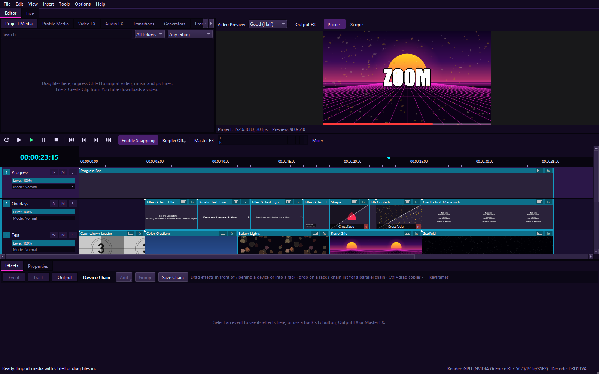
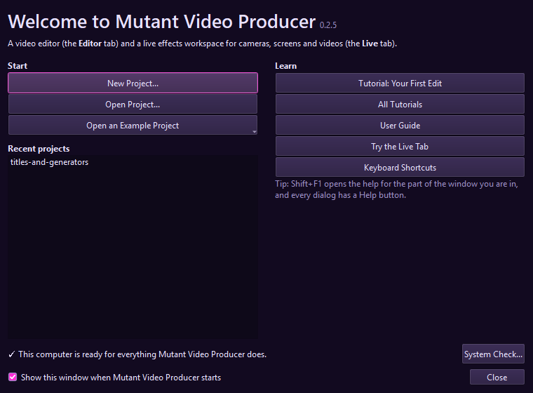

# Getting Started

## The window

Mutant Video Producer opens on the **Editor** tab. The **Live** tab beside it is a separate workspace for
real-time effects (see [Live](live.md)).

The Editor has four areas. Drag the dividers between them to resize them.

- **Top left: the browser tabs.**
  - **Project Media**: the files in the project.
  - **Video FX**, **Audio FX**: effects and their presets.
  - **Transitions**.
  - **Generators**: titles, backgrounds, overlays.
  - **From Live**: clips recorded on the Live tab.
  - **History**: every undo step.
- **Top right: the Video Preview.** It shows the frame at the cursor, or the playing picture. The
  buttons over it switch **Proxies** and **Scopes** on and off.
- **Middle: the transport bar and the timeline.**
  - The transport bar has play, stop, loop, the Ripple button, Master FX, the Mixer button and the
    master level meter.
  - The timeline has tracks, with their headers on the left and events on the right. A file placed
    on a track is called an *event*.
- **Bottom: the Effects and Properties tabs.**
  - **Effects** is the device chain: the effects of the selected event, its track, or the whole output.
  - **Properties** shows the settings of a title, a transition or Pan/Crop.

**View > Theme** changes the colours: seven themes, from the neutral Classic to the cyberpunk Neon
Grid and Night City, and a light one (see [Themes](options.md#themes)).

The status bar at the bottom says what the computer is using, for example
`Render: GPU (NVIDIA GeForce RTX 5070) Decode: D3D11VA`.

## The welcome window

When Mutant Video Producer starts with no project open (the first time, for example), the **Welcome to Mutant Video Producer**
window offers:

- **Start**: **New Project...**, **Open Project...**, **Open an Example Project**, and your recent projects.
- **Learn**: the first tutorial, all tutorials, the user guide, the Live tab, and the keyboard shortcuts.
- A summary of what this computer can do, with **System Check...** for the details (see below).

Untick **Show this window when Mutant Video Producer starts** to skip it. **Help > Welcome Window** opens it again.

## Starting a project

**File > New...** (**Ctrl+N**) asks what shape the video is:

| Shape | Size | For |
|---|---|---|
| Match the first video I add | that video's | anything: the first video you import decides |
| Landscape 1080p | 1920 x 1080 | YouTube and most video |
| Landscape 4K | 3840 x 2160 | 4K YouTube, TVs |
| Landscape 720p | 1280 x 720 | smaller files, quicker editing |
| Vertical 9:16 | 1080 x 1920 | TikTok, Reels, Shorts, Stories |
| Square 1:1 | 1080 x 1080 | Instagram and Facebook feeds |
| Portrait 4:5 | 1080 x 1350 | Instagram feed posts |

and the **frame rate**: 30, 24 (film), 25 (Europe), 60 (smooth motion, games), 50, 29.97, 23.976 or
59.94 fps. **Custom...** sets any size, rate and sample rate. **File > Properties** (**Alt+Enter**)
changes them later. Mutant Video Producer remembers your choice for next time.

## A first edit

The [Your First Edit](tutorials/01-first-edit.md) tutorial goes through this with an example
project. In short:

1. **Import.** Press **Ctrl+I**, or drag files from Explorer into Project Media or straight onto a
   track. Unless you chose a shape in **File > New**, the first video you import sets the project's
   frame size and frame rate. Change them later with **File > Properties** (**Alt+Enter**).
2. **Place.** Drag a file from Project Media onto the timeline. Or double-click it to put it at the
   cursor. A video file goes on as a grouped pair: its picture on a video track and its sound on an
   audio track.
3. **Play.** Press **Space** to play and stop. Stopping returns to where you started. **Enter**
   pauses where you are. Click the ruler or empty track space to move the cursor.
   **J**, **K** and **L** shuttle backwards, stop and play forwards; press J or L again to go faster.
4. **Cut.** Put the cursor where you want to cut and press **S** to split the selected events (or
   every event under the cursor). Select a piece and press **Del** to remove it.
5. **Trim.** Drag the left or right edge of an event to shorten or lengthen it.
6. **Crossfade.** Drag one event so it overlaps another on the same track: the overlap becomes a
   crossfade. Drop a transition from the Transitions tab onto the overlap to change it.
7. **Add a title.** Press **Ctrl+T** to put text at the cursor. Its settings open in the Properties tab.
8. **Add an effect.** Drag an effect from the Video FX tab onto an event. Its controls appear in the
   device chain at the bottom.
9. **Save.** Press **Ctrl+S**. Projects are `.mtg` files. Mutant Video Producer also keeps an autosaved copy while
   you work (see [Media](media.md#autosave-and-recovery)).
10. **Render.** Press **Ctrl+R** (**File > Render As**), pick a template such as *YouTube 1080p*
    and a file name, and render (see [Rendering](rendering.md)).

## Getting help

- **Help > User Guide** opens this guide inside Mutant Video Producer, and **Help > Tutorials** the tutorials.
- **Shift+F1** (**Help > Help on This**) opens the page about the part of the window you are in: the
  timeline, Project Media, the device chain, the Live tab, the Mixer...
- Every dialog has a **Help** button (Shift+F1 works there too). Its page opens in a window you can
  read while the dialog stays open.
- **Ctrl+K** (**Help > Find a Command...**) finds any command by typing part of its name: "split",
  "captions", "proxy". Press Enter to run it.
- Empty areas say how to start: an empty timeline or Project Media explains how to add files.

## Checking your computer

**Help > System Check...** lists what this computer can do, and how to fix what it can't:

- the preview and renders on the graphics card, and hardware video decoding,
- the graphics card's encoders for fast rendering (NVIDIA NVENC, AMD AMF, Intel Quick Sync),
- Remove Background (AI) on the graphics card (DirectML),
- Auto Captions on the graphics card (Vulkan), and which speech models are here,
- VST3 plugins, Create Clip from YouTube, Spout and the OBS virtual camera.

Each line is marked ✓ (ready), ! (works, but could be faster or needs something installed) or ✗ (a
problem), with what to do about it: usually updating the graphics driver.

## If Mutant Video Producer crashes

Mutant Video Producer writes a report when it crashes: what happened and where, the version, and its last log
lines (and on Windows a minidump, for a debugger), in its app data folder's `crashes` folder. The
next start says so and offers to **Show the Report** or **Report on GitHub...**, which opens a new
issue with the report filled in: you see everything before you send it. The work you hadn't saved is
offered back too (see [Autosave and recovery](media.md#autosave-and-recovery)).

## Updates

Once a day, when it starts, Mutant Video Producer asks GitHub whether a newer version is out. If one is, the status
bar says so; click it to open the download page. The request carries only Mutant Video Producer's version number.
**Help > Check for Updates...**
checks now, and **Options > Check for Updates on Start** turns the daily check off.

## Undo

**Ctrl+Z** undoes and **Ctrl+Y** redoes. Almost everything is undoable: edits, effects and their
settings, keyframes, markers, Live pads. The **History** tab lists every step: click one to go
back (or forward) to it.

## Where to next

- The [Tutorials](tutorials/README.md) cover the whole program, one topic at a time.
- [Keyboard Shortcuts](shortcuts.md) lists every key. **Options > Keyboard Shortcuts...** changes them.
