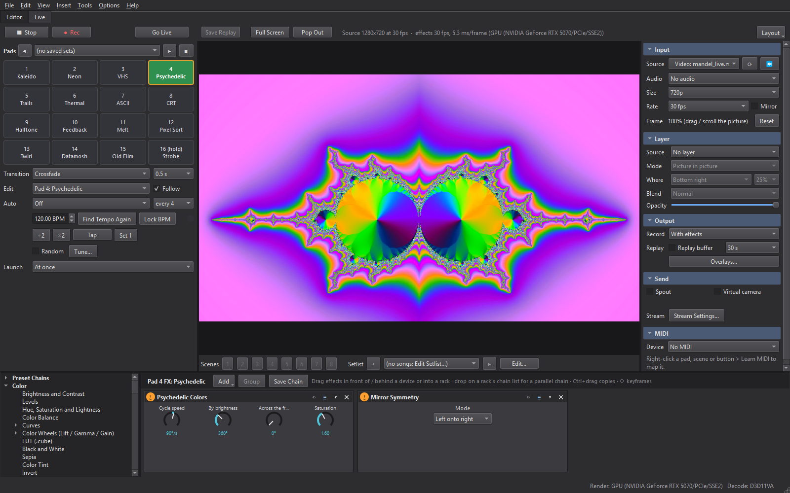

# Live

The **Live** tab plays effects on a camera, a screen, a window or video files in real time. You
switch effects with pads, keys or a MIDI controller, in time with the music, and record, stream,
or send the picture to other programs.

## The layout

- The **show bar** along the top holds what you press during a set: **Start**, **Rec**,
  **Screenshot**, **Go Live**, **Save Replay**, **Full Screen**, **Pop Out**, and the status.
- **Scenes and the setlist** sit under the picture.
- The **setup** (Input, Layer, Output, Send, MIDI) is in sections that fold away. It is chosen
  before a set. The cue appears over it when something is cued.
- The **effects** section underneath has the Video FX list and the **Live FX** device chain. It
  works like the Editor's (racks, presets, knobs, undo) and is saved with the project.

Three layouts arrange the same controls. Switch with the **Layout** button on the show bar, or
**Options > Live Tab Layout**. Each layout remembers its dividers, and each fits a 1366x768 screen.

- **Sidebar**: pads on the left, the picture in the middle, the setup on the right, effects below.
- **Stage**: the picture across the top with the setup beside it; pads and effects share a deck
  below. The biggest picture.
- **Compact**: the picture, with Perform (cue and pads), Setup and Effects in tabs beside it. For
  laptops and small screens.

## Starting

1. In **Setup > Input**, choose the **Source**.
2. Press **Start** (or **Space** on the Live tab).
3. Add effects: drag them into the Live FX chain, or onto a pad.

To remove all always-on effects, select **Live FX (always on)** in the pads' Edit list and click
**Clear All** beside **Save Chain**. This removes the entire chain, including racks, in one undo
step (**Ctrl+Z**). Pad effects and Layer FX are kept.

Switching sources while running reopens at once. Rendering pauses while the Editor tab is shown,
unless something is recording, sending or popped out. Editor playback stops when you switch to Live,
unless the Live tab is taking the Editor timeline.

## Sources

- **Cameras and capture cards** (DirectShow on Windows, V4L2 on Linux). Cameras can be asked for a
  format: 720p, 1080p, 60 fps and so on.
- **Whole screens**, or **a single window** (Windows.Graphics.Capture on Windows 10 and 11, so
  GPU-drawn windows such as browsers and games work; GDI as a fallback; X11 on Linux).
- **Video files**: **Choose video files...** takes one or several. Several play as a playlist, one
  after the other, each at its own speed. **⏭** skips to the next. Chosen playlists stay in the list.
- **Editor timeline**: whatever the Editor tab's preview shows. Starting capture plays the timeline, round and round
  (the time selection when Loop Playback is on, else the whole timeline), and stopping capture stops it. Set up a
  few clips on the timeline, loop them, and play effects, pads and layers on them here. It comes at the preview's
  quality (**Video Preview** in the Editor tab), and the timeline's sound plays as usual. It can be a layer or a
  switcher input too.
- The refresh button looks for new windows and devices.

### Size, frame rate and framing

- **Size** is the output's resolution, which the effects work at (smaller is faster). 1080p, 720p,
  540p and 360p stay 16:9 whatever the source is (a window of any shape, a 4:3 camera); **Framing**
  fits the picture in. **Source size** follows the source's own size and shape instead. **fps** is
  the rate they are rendered at. Effects keep animating even when the source is still.
- **Mirror** flips the picture, for cameras pointing at you.
- **Portrait and square sizes**: 1080x1920, 720x1280 and 540x960 at 9:16 (TikTok, Reels, Shorts,
  Stories), 1080x1350 at 4:5 (feed posts) and 1080x1080. The output becomes exactly that shape, so
  recordings, the stream, Spout and the virtual camera are too.
- **Framing** says how a picture of another shape goes in: cropped to fill (the middle), fitted
  with black bars, or fitted over a blurred copy of itself.

### Pan and zoom

Frame the source right on the picture:

- drag it to move it,
- scroll to zoom (up to 8x, around the point under the mouse),
- right-click for set zooms or **Reset**.

**Setup > Input > Frame** shows the zoom and has Reset too. With a portrait size it picks the part
of a wider source that fills the frame; at other sizes it is a digital zoom. The source is captured
at the zoomed size, so zooming in keeps its detail. A new source starts framed afresh.

### Audio

**Audio** picks the sound for recordings, the stream, beat detection and the audio modulators:

- a microphone, line-in or capture card (DirectShow on Windows, PulseAudio or ALSA on Linux),
- or **Desktop audio**: whatever the computer plays, through the default output or a particular one
  (WASAPI loopback on Windows, PulseAudio monitors on Linux). While nothing plays it records silence.

The meter beside it shows the level. Changing the input while running switches at once.

## The switcher

The switcher keeps up to four more inputs (cameras, screens, windows, video files) open beside the
Source, for multi-camera shows.

1. Add inputs in **Setup > Switcher**. A row of tiles under the picture shows each one live.
2. Click a tile to **preview** it (green).
3. **Cut** (**Enter**) puts it on air (red). **Auto** (**Shift+Enter**) switches with the pads'
   **Transition** and length. What was on air waits in preview.
4. Double-click a tile to cut to it at once. Right-click > **Learn MIDI** maps it to a controller.

Effects, pads, overlays, recording and streaming follow whatever is on air, at the output's size.

## Layers

A **layer** is another source laid over the first: any camera, screen, window or video files. There
are four. Pick one in the Layer section's **Layer** list; the settings under it are that layer's.
Layer 1 is laid over first, layer 4 last (on top).

- **Picture in picture** in a corner or the centre, its **Size** from 5% to 100% of the width, or
  over the **full frame**. Or drag it on the big Live picture to put it anywhere (the pointer becomes
  a four-way arrow over a layer; **Where** then says *Where dragged*). Dragging a layer picks it in
  the Layer list. Dragging anywhere else pans the source, as before.
- A **blend mode** (Normal, Add, Screen, Multiply, Overlay, Lighten, Darken, Difference) and **opacity**.
- Its own effect chain, applied before it is laid over: pick **Layer 1 FX** (2, 3, 4) in the pads'
  Edit list. A Chroma Keyer or Remove Background there gives a green-screen look.
- **No Effects**: the layer is laid over after the Live FX and the pads, so they don't change it (a
  logo or a face cam stays as it is). Its own Layer FX still apply.

The Live FX and pads apply to the picture and every other layer.

## Pads

A 4x4 grid of pads. Each holds its own effect chain, applied on top of the Live FX.

- **Press a pad** to switch it on, and again to switch it off.
- **Pressing another pad** switches to it with the chosen **Transition** (Cut, Crossfade, Dip to
  Color, wipes, Push, Iris, Cross Zoom...) and length.
- **Filling a pad**: drop effects or presets on it, or pick it under **Edit** (or right-click >
  **Edit Chain**) to build its chain in the device chain below.
- Right-click a pad to rename it, copy the Live FX into it, or clear it.
- **Follow** (next to Edit, on by default): the device chain shows the pad you switch on, ready to
  tweak, and the Live FX again when it goes off.
- **Momentary** pads (right-click > **Momentary**) are on only while held down (mouse, key or MIDI),
  on top of whatever pad is on: strobes, freezes, glitch bursts.
- **Lock Pad** (right-click): the pad still plays, but drops, renames, clearing and its chain are
  blocked until it is unlocked.
- **Create Random Effects Chain** (right-click) fills the pad with a random chain and a name to
  match ("Neon Wave", "TOTAL Meltdown"):
  - **Low**: a colour grade and one subtle touch.
  - **Medium**: 3 effects (colour, a glitch, a texture or distortion).
  - **High**: 4-5 effects.
  - **Insane**: 6-8, all pushed hard.

  Each chain is tried on a moving test picture first; chains that are too subtle or too wild, flat,
  or blown out are thrown away. At most one of the slowest effects goes in, so they all play live.
  The **≡** menu's **Fill Empty Pads with Random Chains** fills every empty pad. **Ctrl+Z** undoes it.

### Pad keys

On the Live tab (and its output windows), the keys **1 2 3 4 / Q W E R / A S D F / Z X C V** play
the 16 pads, laid out like the grid. Hold them for momentary pads.

### Launch

**Launch** (in the pads panel) sets when a pressed pad switches: **At once**, **On the next beat**,
or **On the next bar (the 1)**. A waiting pad has a dashed outline; press it again to cancel.
Momentary pads and auto switch always switch at once.

### Sequencer

Under the pads is a looping **piano roll**: one row for each of the 16 pads (their names down the
left; click one to press that pad), the bars numbered along the top. Click on a pad's row to put a
block there, or click and drag to make it as long as you like. Drag a block to move it (to another
row too), drag its right edge to change its length, and right-click (or right-drag over several) to
remove them. **Ctrl+wheel** zooms; **Clear** removes every block (Ctrl+Z brings them back).

- **Bars**: how long the loop is (1 to 64).
- **Time signature**: beats in a bar and the note a beat is (4/4, 3/4, 7/8, 6/8...). Each beat of
  the beat clock is one of those beats.
- **Snap**: where blocks start and end: a bar (1/1), 1/2 down to 1/32, 1/8 or 1/16 triplets, or a
  beat. A new block is as long as the last one you made.

Tick **Sequence** and the loop plays, over and over, while the Live tab runs: it starts on the next
1 of the beat clock (see Tempo and auto switch: the tempo, tapped, from beats heard or from MIDI
clock) and follows it, so a block switches its pad on for its length, in time. Where blocks overlap,
the one that starts last wins; where there is none, the loop switches off the pad it switched on (a
pad you pressed yourself stays). Auto switch waits while the loop plays. The loop is saved with the
project.

### Pad sets

Whole grids saved by name and shared by all projects (the **≡** menu: Save, Save As, New Empty Set,
Delete). Pick a set from the list, or step through them with **◀ ▶**, to swap the whole grid while
performing. A `*` marks changes not saved to the set yet. **Ctrl+Z** undoes a load.

## Cue

**Shift+click** a pad or a scene, or right-click > **Cue**, to see it in the **CUE** panel beside
the output without putting it live. **Take** (or MIDI) puts it live, on the beat or bar if Launch
says so. Cueing it again, or **Close**, closes the cue.

## Scenes

A scene is the whole look at one moment: the Live FX, the active pad, the layers (their sources, how
they are laid over, their effects) and the overlays.

- Right-click a scene button > **Save the Current Look Here**.
- Click it (or press **F1-F8**, or MIDI) to bring the look back, the pad with its transition.

Scenes are saved with the project.

## The setlist

The songs of a set, in order. **Edit...** sets each song's pad set, tempo (locked or not), scene
and a note. **Add Current** takes what is on now.

Choosing a song (the list, **◀ / ▶**, **Page Down / Page Up**, or MIDI: right-click ◀ / ▶ > Learn MIDI):

- loads its pad set,
- sets its tempo, locked at it or listened for from there (no tempo: Find Tempo Again),
- recalls its scene,
- shows its note.

## Tempo and auto switch

**Auto switch** advances the pads by themselves while running, every 1 to 16 beats, in order or at
random, with the chosen transition.

- **Tempo**: type the BPM, or press **Tap** in time.
- **Audio beats**: follow the beats heard on the Audio input. It shows the tempo it hears. The light
  flashes on each beat.
- **MIDI clock** (Auto > MIDI clock): follow a clock from DJ software or a drum machine on the MIDI
  input: the tempo from its ticks, the bar from Start and the song position.
- **Lock BPM**: keep the tempo once it is right. The beats still follow the hits. While locked you
  can type or tap the tempo yourself.
- **Find Tempo Again**: forget the tempo, the lock and any octave set by hand, and listen afresh.
- **÷2 / ×2**: halve or double the tempo when it is heard at twice or half the speed (a 60 BPM song
  read as 120). That octave then stays.
- **Set 1** (or **B**): mark the first beat of a bar. Pressed just after a beat, that beat was the 1;
  otherwise the next one is. Switches every 2 to 16 beats land on bars from there, and the light
  flashes orange on each 1. If the beats were on the off-beats, Set 1 moves them too.
- The BPM shows two decimals: the arrows step 0.01, Page Up / Down 0.1.

The beat clock also drives Launch, modulation and overlays. It runs even with Auto off.

### Beat Detection

**Tune...** next to the BPM opens the **Beat Detection** window: the tempo and how sure it is, and a
live graph of what it hears (the onset curve, the threshold, hits and the beats fired).

- **Listen to**: the full range, bass (kick drum), mids (snare, claps) or highs (hi-hats).
- **Beats**: locked to the tempo (steady), or on every hit.
- **Sensitivity**, **Min gap** (no double triggers), **Min / Max BPM** (which octave the tempo is
  shown in: 174 can read as 87), **Stability** (how slowly the tempo follows changes), **Window**
  (seconds of audio the tempo comes from), **Latency** (beats fire this much early to make up for
  the input's delay: raise it if switches lag).
- Presets: house / techno, hip-hop, drum & bass, live band, every hit. **Defaults** resets them.

How it works: hits are found where the sound rises sharply, and a beat grid locked to them keeps
steady beats through a missed kick. The tempo comes from how every frequency band changes, with a
singing voice left out. It holds through breakdowns, fills and half-time sections, and a new song
takes over in about 10 seconds. The settings are remembered.

## Modulation

Right-click any Live FX, pad or layer knob > **Modulate...** to make it move by itself:

- a **beat pulse** (jumps on every beat and falls back) or a **bar pulse** (on the 1),
- an **LFO** in time with the tempo: sine, triangle, saw up or down, square, or random steps, over
  1/16 of a beat to 16 beats,
- the audio input's **level**, **bass**, **mids** or **highs**,
- a **MIDI controller**: a knob or fader sets the whole range (**Learn** picks it).

**Amount** is how far it moves from the knob's value. Modulated knobs have a dotted ring.
Modulation is saved with the project.

## MIDI

Pick a controller in **Setup > MIDI** (Windows multimedia MIDI; raw MIDI devices on Linux).

An **Xbox controller** (or any XInput controller on Windows; a joystick device on Linux) is in the same list, as
**Xbox controller 1** to 4. Its buttons and D-pad work like keys (Learn MIDI maps them to pads, scenes, Tap, Rec...),
and the triggers and each direction of the two sticks (left stick up, left stick down...) work like knobs that rest at
0: map one to an action and pushing it past half way presses it, or use it in **Modulate > MIDI** (Learn) to move an
effect setting with it. Learn messages name the button or stick.

- Right-click a pad, a switcher tile, **Tap**, **Set 1**, **Find Tempo Again**, **Lock BPM**,
  **Rec**, **Screenshot** or **Save Replay** > **Learn MIDI...**, then press a pad or key on the controller.
- Notes and buttons that send controllers both work, held for momentary pads.
- See also MIDI clock (above) and MIDI modulation.

## Overlays

**Overlays...** draws things over the output (and into recordings):

- text, a picture (a logo), the tempo (BPM), or the time,
- the Audio input as a **Spectrum** (32 bars), a **Waveform**, or a **Ring** of bars.

Each has a position (corners, edges, centre), size, width, colour, opacity, and an optional pulse on
each beat. Overlays are saved with the project.

## Showing the picture

- **Full Screen** (or double-click the picture) shows the output on another monitor if there is
  one, for projectors and capture. **Esc** closes it.
- **Pop Out** moves the picture into its own window, *Mutant Video Producer Live Output*, for example to capture
  it in OBS with a Window Capture. Right-click it for exact sizes (1080p, 720p, the picture's own
  size), Always on Top, or full screen (also **F11** or double-click). Close it to bring the picture
  back. It keeps rendering with the Editor tab shown.

## Recording

- **Rec** records the live output. Press it again to finish the clip.
  - **Clean picture** records the picture before the Live FX, to add effects later in the editor.
  - Recording starts capture if needed, and carries on while you look at the Editor tab.
  - Clips are H.264 MP4 (on the graphics card's encoder when there is one) at the live size and
    frame rate, with a keyframe every second for quick editing, and 48 kHz stereo AAC sound when an
    Audio input is chosen. They are saved in `Videos\Mutant Video Producer Live`.
  - Picture and sound are placed by when they were captured, so they stay in sync even when the
    effects can't keep up with the frame rate.
- **Replay buffer**: while running, keeps the last 15, 30, 60 or 120 seconds of the output in
  memory. **Save Replay** writes them as a clip, named *Replay* and the date, while the buffer carries on.
- **Screenshot** saves the picture on the big display, as it is at that moment (effects, layer and
  overlays included, at the output size), as a PNG named *Screenshot* and the date, in the same
  folder as the recordings (`Videos\Mutant Video Producer Live`). It appears in the Editor's From Live tab
  with the clips, ready to drag onto the timeline as a still.
- Recorded clips appear in the Editor's [From Live](media.md#from-live) tab.

## Sending the picture to other programs

**Setup > Send**, while running, sends the output with its effects and overlays:

- **Spout**: a Spout sender called "Mutant Video Producer" (right-click for another name). OBS (with the Spout2
  plugin), Resolume, TouchDesigner, MadMapper and SpoutCam pick it up as a source, through the
  graphics card with no capture and no delay.
- **Virtual camera**: the *OBS Virtual Camera* webcam (installed with OBS Studio) shows Mutant Video Producer's
  picture, so Zoom, Discord, Teams or a browser can use it as a camera. OBS doesn't need to be
  running, but its own virtual camera has to be off.

Both keep going with the Editor tab shown.

## Streaming (Go Live)

**Go Live** on the show bar streams the output, with the Audio input as its sound (silence when
there is none), to Twitch, YouTube, Facebook, Kick, or any RTMP, RTMPS or SRT server.

1. **Setup > Send > Stream Settings...**: choose the service, paste the **stream key** and set the
   bitrate. The key is kept encrypted for your Windows account.
2. Press **Go Live**.

- The stream is H.264 at a constant bitrate with a keyframe every 2 seconds (on the graphics card's
  encoder when there is one) and AAC sound, at the Live tab's size and frame rate.
- While live, the show bar shows *LIVE on Twitch 0:12:34*, and how many pictures were dropped if
  the connection can't keep up.
- A lost connection stops the stream and says why.
- **End Stream** finishes.
- Recording, the replay buffer, Spout and the virtual camera work at the same time.

## Try it

- [Performing Live](tutorials/14-performing-live.md): the *live-set* example has pads, scenes,
  overlays and a setlist ready.
- [Recording, Streaming and the Switcher](tutorials/15-recording-streaming-switcher.md).
