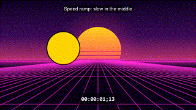

# Speed and Time

## Playback speed

There are three ways to change an event's speed:

- **Ctrl+drag an event's edge** to time-stretch it: the same footage over a new length, so a new speed.
- Right-click > **Playback Speed**: 25%, 50%, 75%, 100%, 150%, 200%, 400% or 800%, **Reverse**, or
  **Custom...**.
- **Event Properties** (**Ctrl+Shift+E**), for:
  - any **Playback rate** from 5% to 2000%,
  - **Play in reverse**,
  - **Keep the same footage**: the event's length changes with the speed. Off, it keeps its length
    and shows more or less of the file,
  - **Blend frames (smoother slow motion)**,
  - **Preserve pitch when the speed changes** (time-stretched), or let the sound follow the speed like tape.

Events at another speed show it on their title bar, for example `[200%]`. A video file's grouped
sound changes speed with its picture.

## Speed ramps

A speed ramp changes the speed over the length of an event.

1. Select events and press **Shift+V**, or right-click > **Speed Ramp > Velocity Envelope**. A
   velocity line appears on the event.
2. Double-click the line to add points.
3. Drag points **up** to go faster (up to 1000%) or **down** to go slower. **0%** freezes the
   frame; below 0% plays backwards.
4. Right-click a point for **Linear**, **Smooth** or **Hold** curves.

Ready-made ramps are under right-click > **Speed Ramp**. They keep the event's footage, so its
length changes:

- **Speed Up (100% to 300%)**
- **Slow Down (100% to 25%)**
- **Slow Motion in the Middle**
- **Fast in the Middle**
- **Freeze in the Middle**

Details:

- Grouped video and audio ramp together.
- The sound follows the ramp in sync, pitch-preserved (or tape-style), and is silent while frozen.
- Ramps survive trimming, splitting and Ctrl+drag stretching.

## Freeze frames

**Shift+F** (**Insert > Freeze Frame**, or right-click a video event > **Freeze Frame at Cursor**):

- holds the picture at the cursor for 2 seconds,
- pushes the rest of the event, and its sound, later.

Trim the held frame to change how long it lasts. Freeze frames hold a picture from a file: generated events (titles,
graphics, backgrounds) can't be frozen; for those, hold the animation instead (a key with the same value).

## Looping a file

Drag an event's end past the end of its file and the file plays again from its start (see
[Editing](editing.md#trimming-and-splitting)).

## Try it

The [Speed, Slow Motion and Ramps](tutorials/10-speed-and-ramps.md) tutorial has an example project
with the same clip at 100%, 50%, 200%, reversed and ramped.
