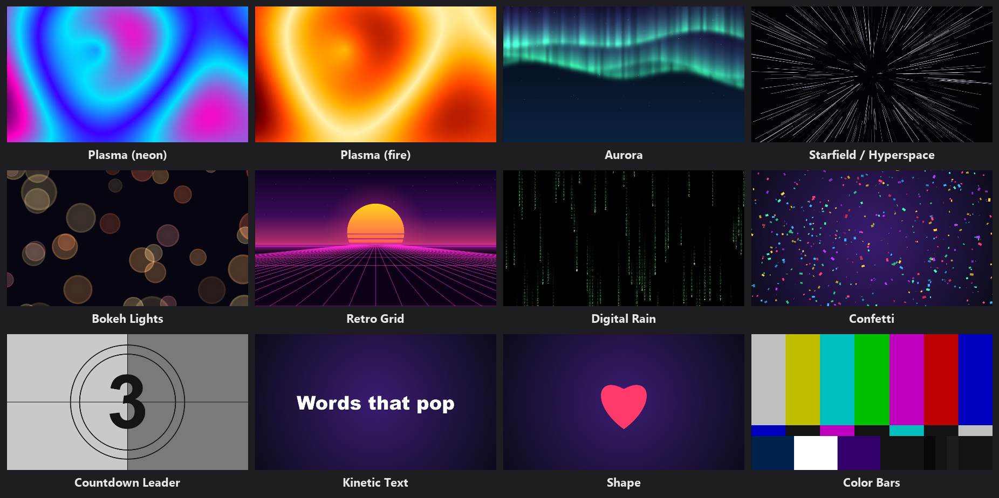
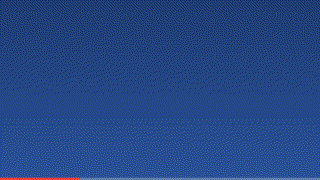

# Titles and Generators

For curved paths, groups, cameras, masks, reusable compositions, audio-reactive graphics and
the animation timeline, see [Animation scenes](animation-scenes.md).

Generated media is drawn by Mutant Video Producer itself: text, titles, backgrounds, overlays and test patterns.
Generated events behave like any other event: trim, move, fade, add effects and transitions.

## Adding one

- **Ctrl+T** (**Insert > Text / Title**) puts a title at the cursor.
- **Insert > Lower Third**, **Insert > Credits Roll** and **Insert > Solid Color** add those.
- Or drag any preset from the **Generators** tab onto a video track, or double-click it to put it at
  the cursor.
- A title dropped wholly inside a video event goes on the track above, so it shows over the picture.

Selecting a generated event opens its settings in the **Properties** tab. Every number and colour
can be [keyframed](effects.md#keyframes).

## Native graphics overlays

The **Graphics** category contains **Broadcast Frame**, **Broadcast Lower Third**, **Information Card**,
**History Timeline** and **Blank Graphics Canvas**. These are editable compositions, not flattened images.
Drag a preset onto the timeline, select it, and click **Compose Graphics…** in Properties.

The composer has a preview with safe-area guides and a layer list ordered bottom to top. Add text,
rectangles, ellipses, lines or an image. Drag a layer to move it; drag its corner to resize it. Edit text,
font, alignment, fill, stroke, opacity, rotation and rounded corners in the inspector. Raise, lower,
duplicate or delete layers. **Apply** is one undo step; **Cancel** discards the draft. Switching a
preset replaces the draft composition. The transparent parts show the footage underneath.

Layout measurements and font size are fractions of the output canvas, so compositions scale with
project resolution. Image layers reference an image file; keep that file with the project assets.
Text and shapes are drawn natively at export resolution. The overlay itself supports event fades,
effects, Pan/Crop, and keyframed opacity. MCP can additionally keyframe individual layer geometry.

## Audio waveform graphics

Drag **Audio Waveform Graphic** from Graphics onto a video track, select it, then click
**Choose Audio Source / Rebuild Waveform…**. Select an imported audio or video file, source in-point,
and span. Analysis has a cancellable progress window. Real left/right audio peaks are embedded in
the project; the graphic works after reopening without a PNG or repeated audio analysis.

Properties control position, size, colours, line thickness, bar spacing, amplitude, visual normalization,
stereo lanes, a playback marker, a scrolling window, and bars/filled-envelope/line styles. **Rate** and
**Playhead offset** align the marker to the excerpt. Normalization affects only the drawing. This
generator neither adds sound nor changes audio levels. It shows the decoded source before timeline
effects, rather than the master mix. Rebuild after replacing the source audio. Excerpts can be up to
one hour long.

Both engines are available to [MCP clients](graphics-mcp.md).

## Text

### Titles & Text

The presets: *Title (centered)*, *Title over subtitle*, *Lower third (name + role)*,
*Subtitle / caption*, *Typewriter* and *Big zoom title*.

Settings:

- **Text** (several lines), **Font**, **Size** (% of the frame height), **Bold**, **Italic**, **Text color**.
- **Alignment**, **Position X / Y**, **Line spacing**, **Letter spacing**.
- **Outline** width and colour.
- **Shadow**: opacity, colour, offset and blur (a soft shadow).
- **Background box**: opacity, colour, padding and corner radius.
- **Animate in / out** and their durations: fade, slide, zoom or typewriter.

On the preview, drag the text to move it and scroll to resize it.

### Kinetic Text

Words pop on one at a time, the newest highlighted, like social-media captions.

- **Words per second**, **Animation** (Pop, Slide up or Fade), **Newest word color**, outline.
- Presets: *Kinetic words* and *Kinetic caption (lower)*.
- [Auto Captions](captions.md) can make kinetic text paced to the speech.

### Credits Roll

Text scrolls up through the frame over the event's length. Make the event longer to scroll slower.
Lines starting with `# ` are headings.

### Timecode

Burns the timecode, or the frame number, into the picture, with an optional prefix. Timecode is hours, minutes,
seconds and frames: `00:01:02:12` at whole frame rates (24, 25, 30, 50, 60), and `00:01:02;12` with a semicolon at
NTSC rates (23.976, 29.97, 59.94), where it follows the clock as drop-frame timecode does.

### Countdown Leader

An old film-leader countdown with a sweeping hand, one number a second. **Count from**, and the
background, sweep and ink colours.

## Backgrounds

| Generator | What it is |
|---|---|
| Solid Color | One colour. |
| Color Gradient | A linear or radial blend between two colours (presets: *Gradient (blue)*, *Radial spotlight*). Drag its centre and angle on the preview. |
| Checkerboard | Alternating squares. |

## Animated backgrounds

| Generator | What it is |
|---|---|
| Plasma | Flowing colour waves. Presets: neon, fire, ocean (slow); palettes include sunset and rainbow. |
| Aurora | Northern lights over a starry sky. |
| Starfield | Flying through the stars. *Hyperspace*: long trails. |
| Bokeh Lights | Soft lights drifting and twinkling. Lower **Background opacity** to lay it over footage (*Bokeh lights (party, overlay)*). |
| Retro Grid | A neon grid racing towards a striped sunset. |
| Digital Rain | Columns of glowing glyphs raining down. |

Animated generators are worked out from the time alone, so any frame renders the same every time.

## Overlays

| Generator | What it is |
|---|---|
| Confetti | Falling, tumbling confetti (party or gold). |
| Progress Bar | A bar that fills up over the length of the event. |
| Letterbox | Cinema bars (2.39:1, 2:1, 1.85:1, 4:3 or 9:16 pillarbox, 1:1) that can slide in and out. |
| Shape | Rectangle, rounded rectangle, ellipse, triangle, star, heart, arrow or ring, with fill and outline. Drag and rotate it on the preview. |

## Test Patterns

**Color Bars**: SMPTE bars at 75%, or full-field 100% bars. Use them with the
[video scopes](video-effects.md#video-scopes).

## Try it

The [Titles and Generators](tutorials/02-titles-and-generators.md) tutorial's example project has
one of nearly everything here.
