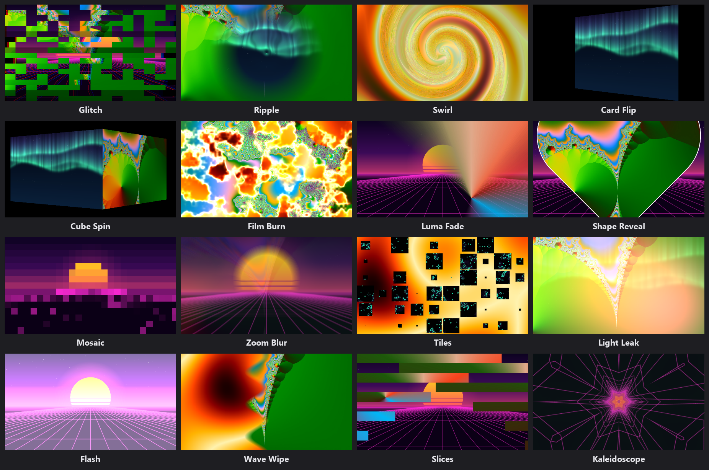
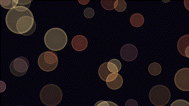

# Transitions

## Adding a transition

- **Between two events**: overlap them on the same track. The overlap is a crossfade. Drag a
  transition from the **Transitions** tab onto the overlap to change it.
- **At an event's start or end**: drop a transition on the start or end of an event to go from (or
  to) the tracks below. A 1-second fade is made if there isn't one.
- Right-click an event > **Transition In** / **Transition Out**. These menus also show the current one.
- Every transition shows its name on the event. Click the name to open its settings in the
  **Properties** tab.
- Transitions follow the event's [fade curve](editing.md#fades-and-level).
- A transition on a video file's picture fades its grouped sound too.

## Removing a transition

Any of these removes one:

- the **×** on its label (audio fades have one too),
- **None (hard cut)** in the Transition In / Out menus,
- **Remove Transitions (both ends)** in the event's right-click menu,
- **Remove Transition** in its Properties.

Then:

- A **fade** simply goes.
- A **crossfade** between overlapping events becomes a cut where the later event starts. The earlier
  event, and its grouped sound, is trimmed there.
- For an event wholly inside a longer one, the longer one is cut before and after it.

## The transitions

| Transition | What it does |
|---|---|
| Crossfade | A smooth blend (the default). |
| Dip to Color | Fades out to a colour (black by default), then in. |
| Linear Wipe | A straight edge sweeps across at any angle. |
| Slide | The next picture slides in over the current one. |
| Push | The next picture pushes the current one out. |
| Iris | A growing shape reveals the next picture. |
| Clock Wipe | A sweeping hand reveals the next picture. |
| Barn Door | Opens from the middle like two doors. |
| Venetian Blinds | Many strips wipe at once. |
| Pixel Dissolve | Random blocks switch over. |
| Cross Zoom | Zooms into the current picture while the next one zooms out into place. |
| Glitch | Bands tear sideways, colours split and blocks flicker over to the next picture. |
| Ripple | Rings spread from a point (drag it on the preview), carrying the next picture. |
| Swirl | The picture twists into a whirlpool and untwists as the next one. |
| Card Flip | Flips over in 3D like a card, from any side. |
| Cube Spin | Both pictures are faces of a turning cube, from any side. |
| Film Burn | The picture burns away in a glowing, ragged edge. |
| Luma Fade | The brightest (or darkest) parts change first. |
| Shape Reveal | A growing star, heart, hexagon, triangle or cross, with a border. |
| Mosaic | Breaks into ever bigger blocks, then sharpens as the next picture. |
| Zoom Blur | Rushes into the picture with a radial blur and out of the next one. |
| Tiles | Tile by tile: diagonal, random, from the centre, or left to right. |
| Light Leak | Warm light flares across the lens while the pictures change. |
| Flash | A burst of light (white by default) hides the cut. |
| Wave Wipe | A wipe with a wavy, moving edge. |
| Slices | Strips of the next picture slide in from alternate sides. |
| Kaleidoscope | Folds into a turning kaleidoscope and unfolds as the next one. |

## Settings and handles

Each transition's settings (direction, colour, softness, shape...) are in the **Properties** tab and
can be keyframed. While Properties shows, you can drag on the preview:

- an iris's or ripple's centre,
- the dot on the line to turn a wipe's or clock wipe's angle.

## Titles over a picture

A title or other generated event dropped (or inserted) wholly inside an event goes on the video track
above it (a free one there, or a new one), so it shows over the picture instead of crossfading.

## On the Live tab

Live pads switch with the same transitions (see [Live](live.md#pads)).

## Try it

The [Transitions](tutorials/03-transitions.md) tutorial's example project plays every transition, named.
